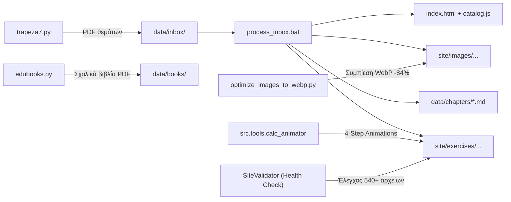

# epal-mech-agent

Content pipeline και εκπαιδευτική σουίτα για τα μαθήματα του Τομέα Μηχανολογίας των ΕΠΑ.Λ. Μετατρέπει τα PDF της Τράπεζας Θεμάτων και των επίσημων σχολικών βιβλίων σε διαδραστικά αρχεία JavaScript έτοιμα για τον στατικό ιστότοπο **[4gnosin.github.io](https://github.com/4gnosin/4gnosin.github.io)**.

Ο ιστότοπος είναι βασισμένος σε vanilla HTML/CSS/JavaScript (GitHub Pages, χωρίς εξωτερικό build step). Περιλαμβάνει έναν **διαδραστικό Player Μαυροπίνακα (Manim-Style Web Animation)** για την αναλυτική, βήμα-προς-βήμα παιδαγωγική επίλυση όλων των υπολογιστικών θεμάτων με KaTeX και high-contrast θεματική απεικόνιση (Light/Dark mode).

---

## 📑 Περιεχόμενα

1. [Κέντρο Ελέγχου & Αυτοματισμών (menu.bat)](#κέντρο-ελέγχου--αυτοματισμών-menubat)
2. [Ροή Εργασίας Πλατφόρμας](#ροή-εργασίας-πλατφόρμας)
3. [Παιδαγωγικά Animations Μαυροπίνακα (Manim Web & Χρυσό Πρότυπο 4 Βημάτων)](#παιδαγωγικά-animations-μαυροπίνακα-manim-web--χρυσό-πρότυπο-4-βημάτων)
4. [Βελτιστοποίηση Εικόνων σε WebP (Εξοικονόμηση Χώρου ~84%)](#βελτιστοποίηση-εικόνων-σε-webp-εξοικονόμηση-χώρου-84)
5. [Δομή Αποθετηρίου](#δομή-αποθετηρίου)
6. [Εγκατάσταση & Ρύθμιση](#εγκατάσταση--ρύθμιση)
7. [Λήψη Θεμάτων από την Τράπεζα (trapeza7.py)](#λήψη-θεμάτων-από-την-τράπεζα-trapeza7py)
8. [Λήψη Σχολικών Βιβλίων Θεωρίας (edubooks.py)](#λήψη-σχολικών-βιβλίων-θεωρίας-edubookspy)
9. [Επεξεργασία του Inbox (process-inbox)](#επεξεργασία-του-inbox-process-inbox)
10. [Στοχευμένη Διόρθωση Ασκήσεων (fix_exercise.bat)](#στοχευμένη-διόρθωση-ασκήσεων-fix_exercisebat)
11. [Κανόνες Παιδαγωγικής Συγγραφής & Σύνταξης](#κανόνες-παιδαγωγικής-συγγραφής--σύνταξης)
12. [Έλεγχος Υγείας & Ορθότητας Αρχείων (Health Check)](#έλεγχος-υγείας--ορθότητας-αρχείων-health-check)
13. [Αναφορά Εντολών CLI](#αναφορά-εντολών-cli)

---

## 🎛️ Κέντρο Ελέγχου & Αυτοματισμών (menu.bat)

Για την απλοποίηση και ενοποίηση όλων των επιμέρους διαδικασιών έχει δημιουργηθεί το **`menu.bat`**, το οποίο παρέχει ένα διαδραστικό κεντρικό μενού διαχείρισης στην κονσόλα των Windows (με υποστήριξη UTF-8 και αυτόματη ενεργοποίηση του Virtual Environment):

```text
====================================================================
                  4GNOSIN.GITHUB.IO - CONTROL CENTER
          Κέντρο Ελέγχου, Αυτοματισμών & AI Agent Πλατφόρμας
====================================================================

  [1] Εκκίνηση Τοπικού Web Server (localhost:8000) & Browser
  [2] Παραγωγή Παιδαγωγικών Animations (Manim Web Animator - AI Agent)
  [3] Βελτιστοποίηση Εικόνων σε WebP (Εξοικονόμηση Χώρου ~84%)
  [4] Επεξεργασία Σχολικών Βιβλίων & Θεωρίας (edubooks / theory)
  [5] Επεξεργασία & Εμπλουτισμός Τράπεζας Θεμάτων (trapeza7)
  [6] Εξαγωγή & Βελτιστοποίηση Σχημάτων από PDF (ArtCraft)
  [7] Έλεγχος Υγείας & Ορθότητας Αρχείων (Health Check Validator)

  [0] Έξοδος
====================================================================
```

Εκτελείται απλά κάνοντας διπλό κλικ στο `menu.bat` ή από γραμμή εντολών:
```cmd
menu.bat
```

---

## 🔄 Ροή Εργασίας Πλατφόρμας



---

## 🎬 Παιδαγωγικά Animations Μαυροπίνακα (Manim Web & Χρυσό Πρότυπο 4 Βημάτων)

Κάθε υπολογιστικό ερώτημα (`kind: "calc"`) συνοδεύεται από έναν ενσωματωμένο **Interactive Blackboard Player** (κουμπί *«🎬 Βήμα-βήμα Επίλυση»*).

### Το Χρυσό Πρότυπο Επίλυσης (Gold Standard - Βάσει των #25806 & #23847):
Η επίλυση οργανώνεται υποχρεωτικά σε **4 αυστηρά παιδαγωγικά βήματα**, ακριβώς όπως παραδίδει ένας άριστος καθηγητής στον πίνακα:

1. **Βήμα 1: Συλλογή Δεδομένων & Έλεγχος/Μετατροπή Μονάδων SI:**
   - Πλήρης καταγραφή όλων των αριθμητικών δεδομένων (από το stem και το υποερώτημα) με τις μονάδες μέτρησής τους.
   - Άμεσος έλεγχος αν οι μονάδες ανήκουν στο Διεθνές Σύστημα (SI).
   - Εάν απαιτείται μετατροπή (π.χ. $\text{bar} \to 10^5\text{ N/m}^2$, $\text{daN/kp} \to \text{N}$, $\text{cm} \to \text{mm}$, $^\circ\text{C} \to \text{K}$), εκτελείται ρητά και αιτιολογημένα στο πρώτο βήμα.
2. **Βήμα 2: Επιλογή Βασικού Τύπου & Αλγεβρική Επίλυση:**
   - Παράθεση του θεμελιώδους φυσικού ή μηχανολογικού τύπου.
   - Πλήρης επεξήγηση των φυσικών συμβόλων.
   - Εάν το ζητούμενο μέγεθος δεν είναι απομονωμένο, γίνεται αναλυτική **αλγεβρική επίλυση** ως προς τη ζητούμενη μεταβλητή (π.χ. $A = \frac{\pi d^2}{4} \implies d^2 = \dots$) **πριν** τοποθετηθούν οι αριθμοί.
3. **Βήμα 3: Αριθμητική Αντικατάσταση & Σταδιακές Απλοποιήσεις:**
   - Τοποθέτηση των αριθμητικών τιμών στον επιλυμένο τύπο.
   - Εκτέλεση των πράξεων με σταδιακά ενδιάμεσα βήματα και απλοποιήσεις (αναγωγή κλασμάτων, απλοποίηση μηδενικών, παραγοντοποιήσεις).
   - **Κατακόρυφη Στοίχιση Ίσων:** Όλες οι διαδοχικές πράξεις στοιχίζονται με `\begin{aligned} ... &= ... \\ &= ... \end{aligned}` και αυξημένο κατακόρυφο κενό (0.28em padding), απαγορεύοντας τις μακροσκελείς οριζόντιες αλυσίδες ισοτήτων.
4. **Βήμα 4: Τελικός Υπολογισμός & Μονάδα Μέτρησης:**
   - Εξαγωγή του τελικού αποτελέσματος (π.χ. τετραγωνική ρίζα, τελική διαίρεση) και τυχόν μετατροπή στην επιθυμητή μονάδα (π.χ. $\text{cm} \to \text{mm}$).
   - Έντονο πλαίσιο επισήμανσης (`highlight: true`) και ρητή υπενθύμιση ότι η αναγραφή της μονάδας μέτρησης είναι υποχρεωτική στις εξετάσεις.

### Universal Auto-Fallback Engine (`site/js/app.js`):
Ακόμα και αν μια παλαιότερη άσκηση δεν διαθέτει προϋπολογισμένο αντικείμενο `animation` στο αρχείο `.js`, η μηχανή του `app.js` (`getAnimationForCalcItem`) εξάγει δυναμικά τα δεδομένα από το `stem` και το `prompt`, αναγνωρίζει τις απαιτούμενες μετατροπές μονάδων και συνθέτει αυτόματα στον περιηγητή το πλήρες 4-step animation!

### Theme-Aware High-Contrast Styling:
Ο μαυροπίνακας υποστηρίζει τόσο το Σκούρο (Dark) όσο και το Ανοιχτόχρωμο (Light) θέμα της πλατφόρμας, διατηρώντας άψογη αντίθεση:
- **Dark Mode:** Σκούρο ανθρακί φόντο `#1e293b`, κιμωλία τίτλων σε θερμό κίτρινο (`#fde047`), μαθηματικά σε λαμπερό λευκό/κυανό.
- **Light Mode:** Απαλό φόντο `#f8fafc`, τίτλοι σε σκούρο κεχριμπαρένιο/καφέ (`#92400e` / `#78350f` με WCAG AAA contrast ratio $\ge 7.8:1$), μαθηματικά σε βαθύ γκρι-μπλε (`#0f172a`).

---

## 🖼️ Βελτιστοποίηση Εικόνων σε WebP (Εξοικονόμηση Χώρου ~84%)

Πολλές εικόνες της Τράπεζας Θεμάτων είχαν εξαχθεί αρχικά σε ασυμπίεστο PNG, καταλαμβάνοντας μεγάλο αποθηκευτικό χώρο στο GitHub Pages (~190 MB σε 960+ αρχεία) με 67 πλήρως πανομοιότυπα διπλότυπα.

Το εργαλείο **`optimize_images_to_webp.py`** (επιλογή `[3]` στο `menu.bat` ή μέσω `optimize_images.bat`):
1. Σαρώνει αναδρομικά το `site/images/` και δημιουργεί SHA-256 signatures για ανίχνευση διπλότυπων.
2. Μετατρέπει αυτόματα όλες τις εικόνες σε σύγχρονο **WebP** (ποιότητα $Q=85$, μέθοδος συμπίεσης 6).
3. Ενημερώνει αυτόματα όλες τις αναφορές στα 540+ αρχεία `.js` του `site/exercises/`.
4. **Αποτέλεσμα:** Μείωση του όγκου των εικόνων από **190.00 MB σε ~30.00 MB** (εξοικονόμηση **160 MB**, ποσοστό **84.2%**), χωρίς καμία ορατή απώλεια ευκρίνειας σε τεχνικά σχήματα και γραφήματα.

---

## 📂 Δομή Αποθετηρίου

```text
agent/
├── menu.bat                          Κεντρικό διαδραστικό μενού ελέγχου & αυτοματισμών
├── anim.bat                          Συντόμευση εκκίνησης του Calc Animator
├── optimize_images.bat               Συντόμευση μετατροπής εικόνων σε WebP
├── optimize_images_to_webp.py        Python script βελτιστοποίησης εικόνων (Pillow)
├── site_server.py                    Ελαφρύς multithreaded web server (port 8000)
├── trapeza7.bat / trapeza7.py        Scraper Τράπεζας Θεμάτων (Playwright)
├── edubooks.bat / edubooks.py        Downloader σχολικών βιβλίων από ebooks.edu.gr
├── process_inbox.bat                 Pipeline επεξεργασίας data/inbox/
├── fix_exercise.bat                  Στοχευμένη διόρθωση άσκησης μέσω URL ή ID
├── requirements.txt
├── .env                              GEMINI_API_KEY, GEMINI_MODEL
├── data/
│   ├── inbox/                        PDF εισόδου (data/inbox/done/ για ολοκληρωμένα)
│   ├── books/                        Σχολικά βιβλία PDF ανά τάξη και μάθημα
│   └── chapters/                     Ενδιάμεσα Markdown αρχεία ανά κεφάλαιο
├── src/
│   ├── cli.py                        Κεντρικό CLI εργαλείο
│   ├── tools/
│   │   ├── calc_animator.py          AI Animator παραγωγής σεναρίων 4 βημάτων (Gemini)
│   │   └── exercise_fixer.py         Μηχανή στοχευμένης διόρθωσης & vector extraction
│   ├── validators/
│   │   └── site_validator.py         Επικυρωτής JavaScript schemas & Health Check
│   ├── generators/                   Γεννήτριες θεωρίας, ασκήσεων και script tags
│   └── utils/                        Εξαγωγείς PDF, εικόνων και δομών δεδομένων
└── site/                             Πλατφόρμα 4gnosin.github.io
    ├── index.html                    Κεντρική σελίδα (SPA με Hash Router)
    ├── css/style.css                 High-contrast theme styling & chalkboard engine
    ├── js/app.js                     KaTeX parser, Blackboard Player & Universal Fallback
    ├── content/catalog.js            Κατάλογος μαθημάτων, τάξεων και κεφαλαίων
    ├── exercises/                    540+ αρχεία JavaScript με 4.000+ ασκήσεις
    └── images/                       Βελτιστοποιημένα τεχνικά σχήματα (WebP)
```

---

## ⚙️ Εγκατάσταση & Ρύθμιση

Απαιτείται Python 3.11 ή νεότερη.

```powershell
# Δημιουργία και ενεργοποίηση virtual environment
python -m venv .venv
.venv\Scripts\Activate.ps1

# Εγκατάσταση εξαρτήσεων
pip install -r requirements.txt

# Εγκατάσταση Playwright Chromium (για το trapeza7.py)
playwright install chromium
```

Ρύθμιση αρχείου `.env` στο root του φακέλου:
```env
GEMINI_API_KEY=<Το κλειδί σας από το Google AI Studio>
GEMINI_MODEL=gemini-3.8-flash
```

---

## 📥 Λήψη Θεμάτων από την Τράπεζα (trapeza7.py)

Μέσω του `menu.bat` (Επιλογή `[5]`) ή απευθείας:
```powershell
python trapeza7.py
```
- Επιλογή τάξης (Β' ή Γ' ΕΠΑ.Λ.).
- Επιλογή μαθήματος από την ενσωματωμένη λίστα.
- Αυτόματος διαχωρισμός εκφώνησης και λύσης με κεφαλίδες `#<bankCode>`.
- Αποθήκευση στο `data/inbox/` σε μορφή `<τάξη>_<slug>_ch<κεφάλαιο>.pdf`.

---

## 📚 Λήψη Σχολικών Βιβλίων Θεωρίας (edubooks.py)

Μέσω του `menu.bat` (Επιλογή `[4]`) ή απευθείας:
```powershell
python edubooks.py --all                # Λήψη όλων των βιβλίων του Τομέα Μηχανολογίας
python edubooks.py --taxi b             # Μόνο βιβλία Β' Τάξης
python edubooks.py --subject antoxi     # Συγκεκριμένο μάθημα (π.χ. Αντοχή Υλικών)
```
Συνδέεται με το `ebooks.edu.gr` και οργανώνει τα PDF στο `data/books/{b|c}/{slug}/`.

---

## 🩺 Έλεγχος Υγείας & Ορθότητας Αρχείων (Health Check)

Μέσω του `menu.bat` (Επιλογή `[7]`) ή με εντολή:
```powershell
python -m src.validators.site_validator
```
Ελέγχει αναδρομικά και τα **544 αρχεία JavaScript** της πλατφόρμας (`site/exercises/`):
- Επαλήθευση εγκυρότητας JSON/JavaScript σύνταξης.
- Έλεγχος υποχρεωτικών πεδίων ανά τύπο (`mc`, `tf`, `match`, `blank`, `calc`).
- Επαλήθευση ύπαρξης όλων των συνδεδεμένων εικόνων στο δίσκο.
- Αυτόματη εξομάλυνση συμβόλων KaTeX και διαφυγών LaTeX.

---

## 📐 Κανόνες Παιδαγωγικής Συγγραφής & Σύνταξης

1. **Μηδενικές Αναφορές σε «ΙΕΠ»:** Απαγορεύεται ρητά η χρήση του ακρωνυμίου «ΙΕΠ» ή παρωχημένων υπηρεσιακών εκφράσεων σε όλα τα κείμενα που αντικρίζει ο μαθητής.
2. **Καμία Διαρροή Κώδικα LaTeX (No LaTeX Leaks):** Όλα τα μαθηματικά σύμβολα, τύποι και ελληνικά γράμματα αποδίδονται αποκλειστικά μέσω του KaTeX parser. Δεν εμφανίζονται ποτέ ωμές εντολές όπως `\sigma\upsilon\nu`, `\eta\mu`, `\frac`, `\sqrt` σε απλό κείμενο.
3. **Σύνταξη Εκθετών:** Ποτέ δεν γράφεται γυμνός εκθέτης στην αρχή μιας μαθηματικής έκφρασης (π.χ. γράφουμε `{}^\circ\text{C}` και όχι `^\circ\text{C}`).
4. **Διατήρηση της Αρχικής Εκφώνησης:** Η εκφώνηση της άσκησης μεταφέρεται ακέραια, με την επίσημη αρίθμηση της Τράπεζας Θεμάτων (2.1, 2.2, 4.1 κ.λπ.).
5. **Ερωτήσεις Ανάπτυξης:** Μετατρέπονται σε διαδραστική πολλαπλή επιλογή (`mc`), με σωστή επιλογή την επίσημη λύση και συνοδευτική επεξήγηση.
6. **Διανυσματικά Σχήματα:** Ανιχνεύονται αυτόματα vector paths και παράγονται crops υψηλής ανάλυσης (200 DPI) σε WebP.

---

## 💻 Αναφορά Εντολών CLI

| Εντολή | Περιγραφή |
|---|---|
| `python -m src.tools.calc_animator` | Παραγωγή 4-Step Manim Web Animations για υπολογιστικές ασκήσεις |
| `python optimize_images_to_webp.py` | Μαζική μετατροπή εικόνων σε WebP και deduplication |
| `python -m src.validators.site_validator` | Πλήρης έλεγχος υγείας και ορθότητας όλων των ασκήσεων |
| `python -m src.cli process-inbox` | Πλήρης επεξεργασία του φακέλου `data/inbox/` |
| `python -m src.cli fix-exercise "<URL/ID>"` | Στοχευμένη επιδιόρθωση θέματος από URL ή κωδικό |
| `python -m src.cli extract-pdf` | Μετατροπή PDF σε Markdown με LaTeX μαθηματικά |
| `python site_server.py` | Τοπικός web server στη θύρα 8000 (multithreaded) |
