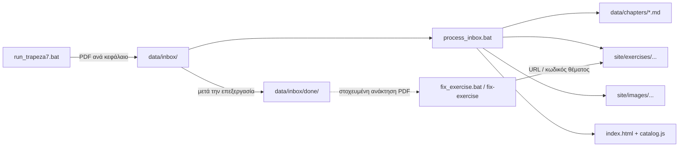

# epal-mech-agent

Content pipeline για τα μαθήματα του Τομέα Μηχανολογίας των ΕΠΑ.Λ. Μετατρέπει τα PDF της Τράπεζας Θεμάτων και των σχολικών βιβλίων σε αρχεία JavaScript έτοιμα για τον στατικό ιστότοπο [4gnosin.github.io](https://github.com/4gnosin/4gnosin.github.io).

Ο ιστότοπος είναι vanilla HTML/CSS/JavaScript (GitHub Pages, χωρίς build step). Ο agent παράγει περιεχόμενο που τηρεί τα schemas του site (`window.SECTIONS`, `window.GROUPS`, `window.EXERCISES`), ενημερώνει το `index.html` και το `content/catalog.js`, και επικυρώνει το αποτέλεσμα πριν το γράψει.

---

## Περιεχόμενα

1. [Ροή εργασίας](#ροή-εργασίας)
2. [Δομή αποθετηρίου](#δομή-αποθετηρίου)
3. [Εγκατάσταση](#εγκατάσταση)
4. [Λήψη θεμάτων από την Τράπεζα (trapeza7.py)](#λήψη-θεμάτων-από-την-τράπεζα-trapeza7py)
5. [Επεξεργασία του inbox (process-inbox)](#επεξεργασία-του-inbox-process-inbox)
6. [Στοχευμένη διόρθωση ασκήσεων (fix_exercise.bat)](#στοχευμένη-διόρθωση-ασκήσεων-fix_exercisebat)
7. [Κανόνες παραγωγής ασκήσεων](#κανόνες-παραγωγής-ασκήσεων)
8. [Ονοματολογία αρχείων](#ονοματολογία-αρχείων)
9. [Συμπεριφορά του site](#συμπεριφορά-του-site)
10. [Αναφορά εντολών CLI](#αναφορά-εντολών-cli)

---

## Ροή εργασίας



Στην καθημερινή χρήση αρκούν τρία εργαλεία:

1. `run_trapeza7.bat` – κατεβάζει τα θέματα και τις λύσεις από την Τράπεζα Θεμάτων και αποθηκεύει τα PDF στο `data/inbox/`.
2. `process_inbox.bat` – επεξεργάζεται όλα τα αρχεία του `data/inbox/`, παράγει τις ασκήσεις στο site και μετακινεί τα αρχεία που ολοκληρώθηκαν στο `data/inbox/done/`.
3. `fix_exercise.bat` – για άμεση, στοχευμένη διόρθωση θέματος όταν εντοπίζεται σφάλμα στο site (επικόλληση URL ή κωδικού).

---

## Δομή αποθετηρίου

```text
agent/
├── run_trapeza7.bat              Εκκίνηση λήψης από την Τράπεζα Θεμάτων
├── process_inbox.bat             Εκκίνηση επεξεργασίας του data/inbox/
├── fix_exercise.bat              Διαδραστική στοχευμένη διόρθωση άσκησης μέσω URL/ID
├── trapeza7.py                   Scraper της Τράπεζας Θεμάτων (Playwright)
├── requirements.txt
├── .env                          GEMINI_API_KEY, GEMINI_MODEL
├── .agents/                      Ορισμοί Subagents (exercise-fixer κ.λπ.)
├── data/
│   ├── inbox/                    Είσοδος: PDF/MD προς επεξεργασία
│   │   └── done/                 Αρχεία που έχουν ήδη επεξεργαστεί
│   └── chapters/                 Ενδιάμεσο Markdown ανά κεφάλαιο
├── prompts/
│   ├── system_prompt.md          Οδηγίες για τον tutor
│   ├── site_theory_prompt.md     Οδηγίες παραγωγής θεωρίας
│   ├── site_exercise_prompt.md   Οδηγίες παραγωγής ασκήσεων
│   ├── site_structure_rules.md   Κανόνες ιεραρχίας και ονοματολογίας
│   └── site_author_prompt.md     Οδηγίες για τον author assistant
├── src/
│   ├── cli.py                    Ενιαίο σημείο εισόδου όλων των εντολών
│   ├── agent.py                  Tutor ανά κεφάλαιο
│   ├── assistant.py              Βοηθός συγγραφής περιεχομένου
│   ├── tools/
│   │   └── exercise_fixer.py     Μηχανή στοχευμένης διόρθωσης, vector extraction & validation
│   ├── generators/
│   │   ├── theory_generator.py
│   │   ├── exercise_generator.py
│   │   └── script_tags_generator.py
│   ├── utils/
│   │   ├── pdf_extractor.py      PDF σε Markdown, καθαρισμός ελληνικού κειμένου
│   │   ├── image_extractor.py    Εξαγωγή και αντιστοίχιση εικόνων ανά θέμα
│   │   ├── structure.py          Ιεραρχία μαθήματος/κεφαλαίου/υποκεφαλαίου
│   │   └── api_retry.py          Επαναλήψεις κλήσεων Gemini (503, rate limits)
│   └── validators/
│       └── site_validator.py     Επικύρωση των schemas του site
└── site/                         Τοπικό αντίγραφο του 4gnosin.github.io
    ├── index.html
    ├── css/style.css
    ├── js/app.js
    ├── content/                  catalog.js, θεωρία
    ├── exercises/                Παραγόμενες ασκήσεις
    ├── images/                   Εικόνες εκφωνήσεων και λύσεων
    └── simulations/
```

---

## Εγκατάσταση

Απαιτείται Python 3.11 ή νεότερη.

```powershell
python -m venv .venv
.venv\Scripts\Activate.ps1

pip install -r requirements.txt

# Μία φορά, για τον browser που χρησιμοποιεί το trapeza7.py
playwright install chromium
```

Αρχείο `.env` στο root:

```env
GEMINI_API_KEY=<κλειδί από το Google AI Studio>
GEMINI_MODEL=gemini-3.8-flash
```

Τα αρχεία `.bat` ενεργοποιούν αυτόματα το `.venv` αν υπάρχει. Διαφορετικά χρησιμοποιείται η Python του συστήματος.

---

## Λήψη θεμάτων από την Τράπεζα (trapeza7.py)

```powershell
run_trapeza7.bat
# ή
python trapeza7.py
```

Το script είναι διαδραστικό:

1. Επιλογή τάξης (Β ή Γ).
2. Επιλογή μαθήματος από τη λίστα `SUBJECTS`.
3. Επιλογή εύρους: ένα κεφάλαιο, πολλά κεφάλαια (`1 2 3` ή `1-4`), όλη η τράπεζα σε ένα PDF, ή όλα τα κεφάλαια σε ξεχωριστά PDF.

Για κάθε θέμα κατεβαίνουν η εκφώνηση και η λύση. Στην πρώτη σελίδα της εκφώνησης προστίθεται κεφαλίδα της μορφής `Θέμα #23824 | 2.4 <τίτλος υποκεφαλαίου>` και στην πρώτη σελίδα της λύσης `Λύση #23824`. Ο extractor βασίζεται σε αυτές τις κεφαλίδες για να διαχωρίσει εκφώνηση από λύση και να αντιστοιχίσει τις εικόνες στο σωστό θέμα.

Τα PDF αποθηκεύονται στο `data/inbox/` με ονόματα που αναγνωρίζει απευθείας το `process-inbox`, για παράδειγμα `c_egkatastaseis-klimatismou_ch02.pdf`.

Για προσθήκη νέου μαθήματος συμπληρώνονται δύο λεξικά στην αρχή του αρχείου: `SUBJECTS` (διαδρομή στο trapeza.iep.edu.gr) και `PDF_SLUGS` (slug του μαθήματος στο site).

---

## Επεξεργασία του inbox (process-inbox)

```powershell
process_inbox.bat
# ή
python -m src.cli process-inbox [--inbox <φάκελος>] [-o <site root>] [-m <μοντέλο>]
```

Για κάθε `.pdf` ή `.md` του `data/inbox/`:

1. Από το όνομα αρχείου εξάγονται τάξη, μάθημα και κεφάλαιο (`<b|c>_<slug>_chNN`).
2. Εξάγονται οι εικόνες του PDF ανά κωδικό θέματος (εικόνες εκφώνησης και λύσης) στο `site/images/`.
3. Το PDF μετατρέπεται τοπικά σε Markdown στο `data/chapters/`, χωρίς κλήσεις AI. Οι εικόνες τοποθετούνται στη θέση που έχουν στη σελίδα, οι πίνακες δύο στηλών (Στήλη Α, Στήλη Β) διαβάζονται με τη σωστή σειρά και αφαιρείται το κείμενο που βρίσκεται μέσα σε εικόνες.
4. Παράγονται οι ασκήσεις μέσω Gemini και επικυρώνονται.
5. Οι εικόνες συνδέονται με τις αντίστοιχες ασκήσεις.
6. Το αρχείο μετακινείται στο `data/inbox/done/`.

Στο τέλος συγχρονίζονται τα `index.html` και `content/catalog.js` για κάθε μάθημα που επηρεάστηκε. Σφάλμα σε ένα αρχείο δεν διακόπτει την επεξεργασία των υπολοίπων. Όλα τα σφάλματα συγκεντρώνονται στο τέλος και η εντολή επιστρέφει κωδικό εξόδου 1.

---

## Στοχευμένη διόρθωση ασκήσεων (fix_exercise.bat)

Όταν εντοπιστεί πρόβλημα σε συγκεκριμένη άσκηση κατά τον έλεγχο στο site (π.χ. λάθος εικόνα, διπλότυπη απεικόνιση, κυριλλικοί χαρακτήρες, ελλιπής αντιστοίχιση), **δεν απαιτείται επαναληπτική εκτέλεση όλου του κεφαλαίου**.

```powershell
fix_exercise.bat
# ή
python -m src.cli fix-exercise "<URL ή κωδικός θέματος>" [--no-ai]
```

### Τρόπος λειτουργίας (Υβριδικό Μοντέλο)

1. **Ανάλυση εισόδου:** Δέχεται είτε το πλήρες URL του browser (π.χ. `file:///.../site/index.html#/thermo/board/ch12-20049` ή `#/thermo/board/ch12-20049`), είτε τον κωδικό του θέματος (`20049` ή `#20049`).
2. **Εντοπισμός αρχείων:**
   - Βρίσκει ακαριαία το σχετικό αρχείο JavaScript στο `site/exercises/`.
   - Αναζητά και ανοίγει **αποκλειστικά** το σχετικό PDF από το `data/inbox/done/` βάσει του μαθήματος και κεφαλαίου, εξοικονομώντας μνήμη και χρόνο.
3. **Τοπική γρήγορη διόρθωση (χωρίς AI - μηδενικό κόστος tokens):**
   - **Διανυσματικά σχέδια (Vector paths):** Αν το θέμα έχει διανυσματικά σχήματα (π.χ. μηχανολογικά σχέδια) χωρίς raster εικόνα στο PDF, το εργαλείο εντοπίζει τις διανυσματικές εντολές και παράγει αυτόματα crop εικόνα υψηλής ανάλυσης (200 DPI) στο `site/images/`.
   - **Εικόνες αντιστοίχισης (`match`):** Εφαρμόζει `imageLayout: "grid"`, `imageLabels: ["Εικόνα 1", "Εικόνα 2", ...]` και αφαιρεί τυχόν περιττές/διπλότυπες εικόνες στο root της άσκησης.
   - **Εξομάλυνση χαρακτήρων:** Μετατρέπει αυτόματα κυριλλικά ομόγλυφα (а, е, о, р, с κ.λπ.) στα σωστά ελληνικά αντίστοιχα.
   - **Έλεγχος ζευγών:** Ελέγχει και διορθώνει τα ζεύγη αριστερής/δεξιάς στήλης.
   - **Επικύρωση:** Εκτελεί τον `SiteValidator` για να εγγυηθεί ότι το αρχείο παραμένει απόλυτα συμβατό.
4. **AI Fallback (Gemini API):** Αν η άσκηση απαιτεί δομική επαναδιατύπωση ή νέα επίλυση, αποστέλλεται στοχευμένο prompt μόνο για το συγκεκριμένο θέμα με το ακριβές απόσπασμα του PDF.

> [!TIP]
> **Subagent `exercise-fixer`:** Στο περιβάλλον του Antigravity είναι διαθέσιμος ο εξειδικευμένος υπο-πράκτορας `exercise-fixer`, ο οποίος μπορεί να κληθεί αυτόματα για την εκτέλεση στοχευμένων διορθώσεων.

---

## Κανόνες παραγωγής ασκήσεων

Οι κανόνες ορίζονται στα `prompts/site_exercise_prompt.md` και `prompts/site_structure_rules.md` και εφαρμόζονται σε κάθε νέα παραγωγή.

**Πιστή αντιγραφή της εκφώνησης.** Η εκφώνηση μεταφέρεται αυτούσια, με την αρίθμηση της Τράπεζας (2.1, 2.2, 4.1 κ.λπ.). Το μοντέλο δεν σπάει ένα θέμα σε μικρότερα ερωτήματα και δεν αναδιατυπώνει. Πρώτα αντιγράφεται η εκφώνηση και μετά σχεδιάζεται η λύση, σε διαδραστική μορφή όπου αυτό είναι εφικτό.

**Ερωτήσεις ανάπτυξης.** Δεν παραλείπονται. Η εκφώνηση γράφεται κανονικά και η λύση δίνεται ως πολλαπλή επιλογή, με σωστή απάντηση την ενδεικτική λύση της Τράπεζας. Προστίθεται σημείωση ότι στην Τράπεζα Θεμάτων το ερώτημα είναι ανάπτυξης.

**Ερωτήματα σε διάγραμμα.** Όταν ζητείται εργασία πάνω σε χάρτη ή διάγραμμα (π.χ. εντοπισμός σημείου στον ψυχρομετρικό χάρτη), εμφανίζεται μόνο η εκφώνηση μαζί με την εικόνα, χωρίς προσπάθεια αυτόματης διάδρασης.

**Υποστηριζόμενοι τύποι.** `mc` (πολλαπλή επιλογή), `tf` (σωστό/λάθος), `match` (αντιστοίχιση), `blank` (συμπλήρωση κενών), `calc` (υπολογιστικές βήμα προς βήμα με ανοχές).

**Πολλαπλές εικόνες & αντιστοίχιση (`match`).** Όταν τα στοιχεία αντιστοίχισης αντιστοιχούν σε πολλαπλές εικόνες, χρησιμοποιείται διάταξη πλέγματος (`imageLayout: "grid"`) με πίνακα `images` και ετικέτες `imageLabels: ["Εικόνα 1", "Εικόνα 2", ...]`. Αποφεύγεται η διπλή δήλωση εικόνας στο root (`ex.image`) όταν οι εικόνες ανήκουν στα επιμέρους items, ώστε να μην εμφανίζεται η εικόνα δύο φορές.

**Διανυσματικά σχέδια & εξαγωγή εικόνων.** Πολλά τεχνικά θέματα (μηχανολογικά σχέδια, εξαρτήματα, κυκλώματα) περιέχουν διανυσματικές γραμμές (vector paths) αντί για raster εικόνες. Ο pipeline ανιχνεύει αυτόματα περιοχές με $\ge 12$ διανυσματικά σχήματα και εξάγει υψηλής ποιότητας crops (200 DPI) στο `site/images/`.

**Ενιαία συμπλήρωση κενών (`blank`).** Όταν μια άσκηση διαθέτει πολλαπλά κενά με κοινή δεξαμενή λέξεων (word bank), παράγεται ένα ενιαίο `blank` item με πολλαπλά tokens `[blank]`, αντί να κατακερματίζεται σε πανομοιότυπα ξεχωριστά items.

**Εξομάλυνση ελληνικών χαρακτήρων & κυριλλικά ομόγλυφα.** Κατά την εξαγωγή από PDF διορθώνονται αυτόματα κυριλλικά ομόγλυφα (а, е, о, р, с κ.λπ.) που παράγονται από ελαττωματικές γραμματοσειρές των PDF, διασφαλίζοντας σωστή αναζήτηση και απόδοση.

**Μεταδεδομένα.** Κάθε άσκηση φέρει κωδικό θέματος, μονάδες, μάθημα και υποκεφάλαιο. Από αυτά το site δημιουργεί αυτόματα την κεφαλίδα της άσκησης. Ο τίτλος δεν επαναλαμβάνεται μέσα στην εκφώνηση.

---

## Ονοματολογία αρχείων

| Αντικείμενο | Μορφή | Παράδειγμα |
|---|---|---|
| PDF εισόδου | `<b\|c>_<slug>_chNN.pdf` | `c_egkatastaseis-klimatismou_ch02.pdf` |
| Markdown κεφαλαίου | `<b\|c>_<slug>_chNN.md` | `c_egkatastaseis-klimatismou_ch02.md` |
| Αρχείο ασκήσεων | `chNN-MM-<περιγραφή>.js` | `ch02-04-psychrometry.js` |
| Group id | `chNN-MM-<περιγραφή>` | `ch02-04-psychrometry` |

Το `NN` είναι το κεφάλαιο και το `MM` το υποκεφάλαιο, πάντα διψήφια. Η ιεραρχία μάθημα, κεφάλαιο, υποκεφάλαιο, άσκηση προκύπτει από τα δεδομένα και όχι από σταθερές αντιστοιχίσεις στον κώδικα.

Για υπάρχουσες ασκήσεις με παλιά ονόματα:

```powershell
python -m src.cli fix-stems --rename
```

---

## Συμπεριφορά του site

**Κεφαλίδα άσκησης.** Πάνω από κάθε άσκηση εμφανίζεται:

```text
Εγκαταστάσεις Κλιματισμού – 2.4 Η αποτύπωση των θερμοδυναμικών χαρακτηριστικών
Σωστό / Λάθος · 25 μονάδες
Θέμα 2ο · #23824
```

**Πλοήγηση.** Στην αριστερή στήλη η ενεργή άσκηση, ή η ενεργή ενότητα θεωρίας, τοποθετείται στο κέντρο της στήλης. Αυτό ισχύει και όταν ο χρήστης επιλέγει άσκηση και όταν πατά «Επόμενη». Η κύλιση γίνεται μόνο μέσα στη στήλη και η υπόλοιπη σελίδα δεν μετακινείται. Η λογική βρίσκεται στη συνάρτηση `centerActiveNav()` του `site/js/app.js`.

**Μεγέθη γραμματοσειράς.** Ρυθμίζονται κεντρικά με CSS variables στην αρχή του `site/css/style.css`:

| Μεταβλητή | Περιοχή |
|---|---|
| `--fs-exercise-kicker` | Γραμμή μαθήματος/υποκεφαλαίου και τύπου/μονάδων |
| `--fs-exercise-title` | Τίτλος `Θέμα 2ο · #23824` |

---

## Αναφορά εντολών CLI

Όλες οι εντολές εκτελούνται από το root με `python -m src.cli <εντολή>`. Η επιλογή `-m` ορίζει μοντέλο Gemini διαφορετικό από αυτό του `.env`.

| Εντολή | Περιγραφή |
|---|---|
| `process-inbox` | Πλήρης επεξεργασία του `data/inbox/` (βλ. παραπάνω) |
| `fix-exercise` | Στοχευμένη επιδιόρθωση άσκησης από URL ή κωδικό θέματος (`--no-ai` για αποκλειστικά τοπική διόρθωση) |
| `extract-pdf` | PDF σε Markdown, προαιρετικά με αποκατάσταση τύπων σε LaTeX (`--ai-clean`) |
| `build-chapter` | Θεωρία, ασκήσεις και script tags για ένα κεφάλαιο, από Markdown ή PDF |
| `build-batch` | Μαζική παραγωγή για όλα τα Markdown ενός φακέλου |
| `generate-theory` | Μόνο αρχεία θεωρίας |
| `generate-exercises` | Μόνο αρχεία ασκήσεων |
| `fix-stems` | Καθαρισμός περιττών stem και μετονομασία σε `chNN-` (`--rename`) |
| `validate` | Επικύρωση αρχείου ή φακέλου `.js` έναντι των schemas του site |
| `tutor` | Διαδραστικός καθηγητής περιορισμένος στην ύλη ενός κεφαλαίου |
| `assistant` | Βοηθός συγγραφής περιεχομένου για τον διαχειριστή του site |

### Παραδείγματα

```powershell
# Στοχευμένη διόρθωση άσκησης από link του site (ή κωδικό θέματος)
python -m src.cli fix-exercise "file:///.../site/index.html#/thermo/board/ch12-20049"
python -m src.cli fix-exercise 20049 --no-ai

# Εξαγωγή εύρους σελίδων από βιβλίο
python -m src.cli extract-pdf -p "C:\books\thermod.pdf" -o data/chapters/b_thermod_ch02.md `
    --start-page 45 --end-page 62 -t "Κεφάλαιο 2" --ai-clean

# Ένα κεφάλαιο απευθείας από PDF
python -m src.cli build-chapter -i "C:\books\thermod.pdf" --start-page 45 --end-page 62 `
    -g b -s thermod -c 2 -o site

# Μόνο ασκήσεις (τάξη, μάθημα και κεφάλαιο από το όνομα αρχείου)
python -m src.cli generate-exercises -i data/chapters/c_egkatastaseis-klimatismou_ch02.md -o site

# Μαζική παραγωγή για υπάρχον μάθημα
python -m src.cli build-batch --input-dir data/chapters -g b -s thermod -o site

# Επικύρωση
python -m src.cli validate site/exercises

# Tutor
python -m src.cli tutor -l
python -m src.cli tutor -c c_egkatastaseis-klimatismou_ch02 -q "Τι είναι το σημείο δρόσου;"
```

### Σημειώσεις

- Όταν το `-o` δείχνει στο root του site (φάκελος με `index.html` και `content/catalog.js`), προστίθενται μόνο τα `<script>` tags που λείπουν και ενημερώνεται η καταχώριση του μαθήματος στον κατάλογο. Δεν δημιουργούνται νέα μαθήματα ή routes.
- Ερωτήματα που δεν μπορούν να τεκμηριωθούν από την πηγή αναφέρονται στην έξοδο ως μη μετατραπέντα και δεν γράφονται στο site.
- Οι κλήσεις στο Gemini επαναλαμβάνονται αυτόματα σε προσωρινά σφάλματα (503, υψηλός φόρτος).
