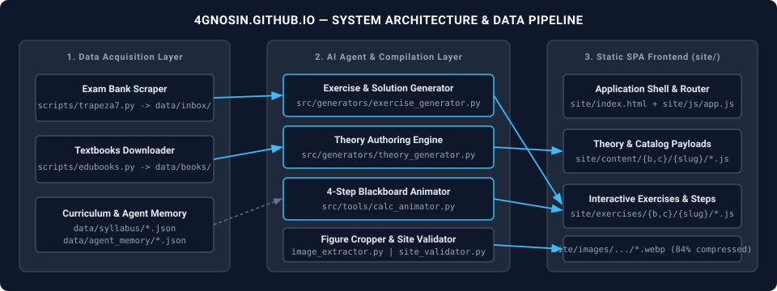
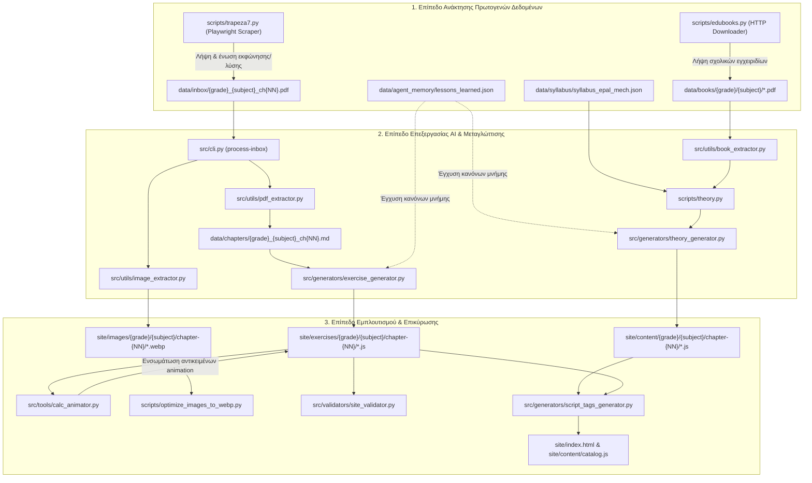
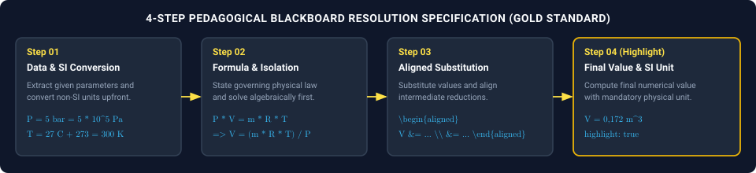
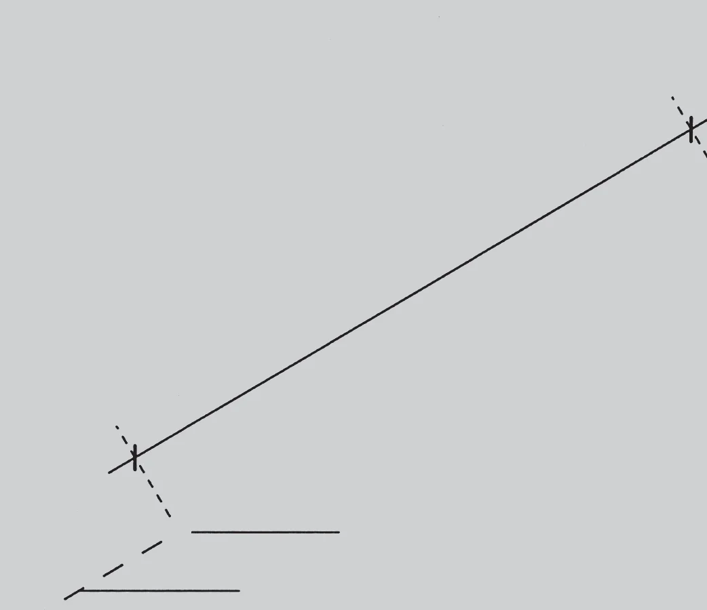

# 4gnosin.github.io — Σύστημα Αυτοματισμού & Πλατφόρμα Μηχανολογίας ΕΠΑ.Λ.

Σύστημα εξαγωγής δεδομένων, αυτοματοποιημένης συγγραφής εκπαιδευτικού υλικού μέσω Μεγάλων Γλωσσικών Μοντέλων (Google Gemini API) και στατικής διαδικτυακής απεικόνισης (Single-Page Application) για τα μαθήματα του Τομέα Μηχανολογίας των ΕΠΑ.Λ. (Β' και Γ' Τάξη).

Το αποθετήριο συνδυάζει δύο διακριτά αλλά πλήρως ενοποιημένα επίπεδα:
1. **Backend Content & AI Pipeline (`src/`, `scripts/`, `prompts/`, `data/`):** Υποσύστημα Python το οποίο ανακτά επίσημα PDF από την Τράπεζα Θεμάτων Διαβαθμισμένης Δυσκολίας και τα Ψηφιακά Σχολικά Βιβλία, εξάγει κείμενο και τεχνικά σχήματα, συνθέτει αναλυτική θεωρία και πλήρως επιλυμένες διαδραστικές ασκήσεις, και επικυρώνει συντακτικά και παιδαγωγικά τα παραγόμενα αρχεία.
2. **Static SPA Frontend (`site/`):** Διαδικτυακή εφαρμογή βασισμένη σε καθαρή HTML5, CSS3 και Vanilla JavaScript (ES6+), χωρίς εξωτερικό bundler ή build step, σχεδιασμένη για άμεση εκτέλεση τοπικά (`file://` ή μέσω τοπικού HTTP server) και φιλοξενία σε GitHub Pages (`4gnosin.github.io`).



---

## Περιεχόμενα

1. [Αρχιτεκτονική Συστήματος και Ροή Δεδομένων](#1-αρχιτεκτονική-συστήματος-και-ροή-δεδομένων)
2. [Δομή Αποθετηρίου και Αρμοδιότητες Αρχείων](#2-δομή-αποθετηρίου-και-αρμοδιότητες-αρχείων)
3. [Αρχιτεκτονική Frontend SPA και Μηχανισμός Φόρτωσης](#3-αρχιτεκτονική-frontend-spa-και-μηχανισμός-φόρτωσης)
4. [Προδιαγραφές Δομών Δεδομένων JavaScript (Data Schemas)](#4-προδιαγραφές-δομών-δεδομένων-javascript-data-schemas)
5. [Μηχανή Μαυροπίνακα 4 Βημάτων (Manim-Style Web Animation)](#5-μηχανή-μαυροπίνακα-4-βημάτων-manim-style-web-animation)
6. [Υποσυστήματα Παραγωγής Περιεχομένου και Pipelines](#6-υποσυστήματα-παραγωγής-περιεχομένου-και-pipelines)
7. [Εξαγωγή Τεχνικών Σχημάτων και Βελτιστοποίηση WebP](#7-εξαγωγή-τεχνικών-σχημάτων-και-βελτιστοποίηση-webp)
8. [Αυστηροί Κανόνες Σύνταξης και Τεχνικοί Περιορισμοί (AI Context Invariants)](#8-αυστηροί-κανόνες-σύνταξης-και-τεχνικοί-περιορισμοί-ai-context-invariants)
9. [Εγκατάσταση, Ρύθμιση και Αναφορά Εντολών CLI](#9-εγκατάσταση-ρύθμιση-και-αναφορά-εντολών-cli)

---

## 1. Αρχιτεκτονική Συστήματος και Ροή Δεδομένων

Η ροή δεδομένων του συστήματος είναι ντετερμινιστική και μετατρέπει πρωτογενή έγγραφα PDF σε στατικά αρχεία JavaScript τα οποία εγγράφουν τα δεδομένα τους στο καθολικό αντικείμενο `window.SUBJECT_DATA`.



---

## 2. Δομή Αποθετηρίου και Αρμοδιότητες Αρχείων

Το ριζικό επίπεδο (root) του αποθετηρίου διατηρείται αυστηρά καθαρό. Περιέχει αποκλειστικά τον κεντρικό εκκινητή `4gnosin.bat`, τη συντόμευση του ιστότοπου `Site (index.html).lnk` και τα αρχεία ρυθμίσεων. Όλα τα εκτελέσιμα scripts βρίσκονται στον φάκελο `scripts/` και όλη η βιβλιοθήκη Python στον φάκελο `src/`.

```text
agent/
├── 4gnosin.bat                       Κεντρικό σημείο εκκίνησης του Control Center (Windows Batch)
├── Site (index.html).lnk             Συντόμευση απευθείας ανοίγματος του site/index.html στον browser
├── requirements.txt                  Εξαρτήσεις πακέτων Python
├── .env                              Μεταβλητές περιβάλλοντος (GEMINI_API_KEY, GEMINI_MODEL)
├── README.md                         Αρχιτεκτονική τεκμηρίωση και προδιαγραφές συστήματος
│
├── scripts/                          Αυτοτελή εργαλεία εκτέλεσης (.py) και βοηθητικά scripts (.bat)
│   ├── menu.py                       Κεντρική διαδραστική κονσόλα ελέγχου (4gnosin Control Center)
│   ├── 4gnosin.py                    Alias εκκίνησης του menu.py
│   ├── trapeza7.py                   Playwright scraper για την Τράπεζα Θεμάτων (trapeza.iep.edu.gr)
│   ├── edubooks.py                   Downloader σχολικών βιβλίων PDF από το ebooks.edu.gr (Διόφαντος)
│   ├── theory.py                     CLI παραγωγής διδακτικής θεωρίας ανά μάθημα και κεφάλαιο
│   ├── optimize_images_to_webp.py    Μαζικός μετατροπέας PNG/JPG σε WebP, deduplicator και ενημέρωση JS
│   ├── extract_pdf_images_craft.py   Εξαγωγέας σχημάτων PDF μέσω της σουίτας ArtCraft CLI
│   ├── site_server.py                Πολυνηματικός τοπικός HTTP server (ThreadingHTTPServer, port 8000)
│   └── *.bat                         Μεμονωμένοι εκκινητές (anim, edubooks, fix_exercise, theory, trapeza7 κ.λπ.)
│
├── src/                              Πυρήνας λογισμικού Python (modular package)
│   ├── cli.py                        Κεντρικός CLI ελεγκτής (process-inbox, fix-exercise, extract-pdf, sync)
│   ├── agent.py                      Κλάση επικοινωνίας με το Google GenAI SDK
│   ├── assistant.py                  Διαδραστικός βοηθός κονσόλας
│   ├── generators/
│   │   ├── exercise_generator.py     Μετατροπή Markdown θεμάτων σε δομημένα αρχεία JS ασκήσεων
│   │   ├── theory_generator.py       Σύνθεση ενοτήτων θεωρίας από PDF βιβλίων και JSON ύλης
│   │   └── script_tags_generator.py  Αυτόματη ενημέρωση των <script> tags στο site/index.html
│   ├── tools/
│   │   ├── calc_animator.py          Γεννήτρια σεναρίων επίλυσης 4 βημάτων για υπολογιστικές ασκήσεις
│   │   └── exercise_fixer.py         Εργαλείο στοχευμένης επιδιόρθωσης μεμονωμένων ασκήσεων και σχημάτων
│   ├── utils/
│   │   ├── pdf_extractor.py          Εξαγωγή κειμένου και μαθηματικών από PDF μέσω Gemini Vision/PDF API
│   │   ├── image_extractor.py        Ανίχνευση bounding boxes, vector paths και περικοπή σχημάτων από PDF
│   │   ├── craft_image_extractor.py  Γέφυρα διασύνδεσης με τα εργαλεία PdfCraft, PhotoCraft και VectorCraft
│   │   ├── book_extractor.py         Κόφτης σελίδων σχολικών βιβλίων PDF ανά κεφάλαιο
│   │   ├── latex_sanitizer.py        Κανονικοποίηση LaTeX/KaTeX, διόρθωση διαφυγών και ελληνικής τριγωνομετρίας
│   │   ├── agent_memory.py           Διαχειριστής μόνιμης μνήμης κανόνων και διορθώσεων του AI Agent
│   │   ├── structure.py              Διαχείριση ιεραρχίας φακέλων και ονοματοδοσίας αρχείων
│   │   └── api_retry.py              Μηχανισμός exponential backoff για κλήσεις API
│   └── validators/
│       └── site_validator.py         Στατικός αναλυτής και επικυρωτής όλων των αρχείων JS και εικόνων του site
│
├── prompts/                          Πρότυπα οδηγιών συστήματος (System Prompts) για το Gemini API
│   ├── system_prompt.md              Βασική ταυτότητα και παιδαγωγικές αρχές του Agent
│   ├── site_theory_prompt.md         Προδιαγραφές συγγραφής θεωρίας (δομή blocks, KaTeX, τυπογραφία)
│   ├── site_exercise_prompt.md       Προδιαγραφές παραγωγής ασκήσεων και λύσεων Τράπεζας Θεμάτων
│   ├── site_author_prompt.md         Οδηγίες μετατροπής PDF σε ενδιάμεσο Markdown
│   └── site_structure_rules.md       Κανόνες ταξινόμησης, αρίθμησης και οργάνωσης καταλόγου
│
├── data/                             Αποθήκη δεδομένων εισόδου, ενδιάμεσων αρχείων και μνήμης
│   ├── inbox/                        Εισερχόμενα PDF θεμάτων προς επεξεργασία (και υποφάκελος done/)
│   ├── books/                        Σχολικά εγχειρίδια PDF ταξινομημένα ανά τάξη (b/, c/) και μάθημα
│   ├── chapters/                     Ενδιάμεσα αρχεία Markdown (.md) που εξάγονται από τα PDF
│   ├── syllabus/                     Δομημένη διδακτέα ύλη (syllabus_epal_mech.json)
│   └── agent_memory/                 Αρχείο μόνιμης μνήμης (lessons_learned.json)
│
├── site/                             Στατική εφαρμογή Ιστού (4gnosin.github.io)
│   ├── index.html                    Κέλυφος της SPA εφαρμογής και σειριακή φόρτωση όλων των scripts
│   ├── css/style.css                 Κεντρικό φύλλο στυλ (Light/Dark theme variables, layout, blackboard)
│   ├── js/app.js                     Μηχανή routing, rendering, διαδραστικών ασκήσεων και Blackboard Player
│   ├── content/
│   │   ├── catalog.js                Κατάλογος τάξεων, μαθημάτων και κατάστασης διαθεσιμότητας
│   │   ├── links.js                  Δεδομένα σελίδας χρήσιμων συνδέσμων
│   │   ├── math.js & math/*.js       Ενότητες και διαδραστικές ασκήσεις Βασικών Μαθηματικών
│   │   └── {b,c}/{subject}/          Αρχεία θεωρίας ανά κεφάλαιο (chapter-NN/MM-slug.js)
│   ├── exercises/
│   │   └── {b,c}/{subject}/          Αρχεία ομάδων (groups.js) και ασκήσεων (chNN-MM-slug.js)
│   ├── images/
│   │   ├── {b,c}/{subject}/          Βελτιστοποιημένα σχήματα WebP εκφωνήσεων, λύσεων και θεωρίας
│   │   └── docs/                     Διαγράμματα αρχιτεκτονικής τεκμηρίωσης
│   └── simulations/                  Αυτοτελείς διαδραστικές προσομοιώσεις (JS/CSS/3D)
│
└── scratch/                          Απομονωμένος χώρος για πρόχειρα scripts ελέγχου και δοκιμές
```

---

## 3. Αρχιτεκτονική Frontend SPA και Μηχανισμός Φόρτωσης

Η εφαρμογή στο `site/` είναι σχεδιασμένη ώστε να λειτουργεί **χωρίς HTTP server** (απευθείας μέσω πρωτοκόλλου `file:///`) καθώς και σε οποιονδήποτε στατικό εξυπηρετητή (GitHub Pages).

### 3.1 Απουσία `fetch()` και Καθολικός Χώρος Ονομάτων
Λόγω των περιορισμών CORS των σύγχρονων φυλλομετρητών στο πρωτόκολλο `file:///`, η εφαρμογή **δεν** χρησιμοποιεί `fetch()` ή ES Modules (`import`/`export`) για την ανάκτηση περιεχομένου. Αντί αυτού:
1. Κάθε αρχείο θεωρίας και ασκήσεων είναι ένα έγκυρο script JavaScript το οποίο προσαρτά τα δεδομένα του στο καθολικό αντικείμενο `window.SUBJECT_DATA["<subject_slug>"]`.
2. Το `site/index.html` φορτώνει σειριακά με `<script src="...">`:
   - Πρώτα το `content/catalog.js` (`window.CATALOG`).
   - Έπειτα τα αρχεία θεωρίας `content/{b,c}/{slug}/chapter-NN/*.js`.
   - Έπειτα, για κάθε κεφάλαιο ασκήσεων, **πρώτα** το `groups.js` και αμέσως μετά τα αρχεία ασκήσεων `chNN-MM-*.js`.
   - Τέλος, τις βιβλιοθήκες KaTeX και τον πυρήνα της εφαρμογής `js/app.js`.

### 3.2 Δρομολόγηση (Hash Routing) στο `site/js/app.js`
Η πλοήγηση βασίζεται στο `window.location.hash` (συμβάν `hashchange`):
- `#/` : Αρχική σελίδα επιλογής τάξης και οριζόντιων ενοτήτων.
- `#/grade/b`, `#/grade/c` : Κατάλογος μαθημάτων Β' και Γ' Τάξης ΕΠΑ.Λ.
- `#/<subject_slug>` : Επισκόπηση μαθήματος (κεφάλαια θεωρίας και σύνοψη ασκήσεων).
- `#/<subject_slug>/section/<section_slug>` : Προβολή ενότητας θεωρίας.
- `#/<subject_slug>/exercises` : Συγκεντρωτικός πίνακας ασκήσεων Τράπεζας Θεμάτων.
- `#/<subject_slug>/exercises/<exercise_id>` : Σελίδα διαδραστικής επίλυσης συγκεκριμένου θέματος.
- `#/simulations`, `#/math`, `#/links` : Ειδικές ενότητες προσομοιώσεων, μαθηματικών και συνδέσμων.

---

## 4. Προδιαγραφές Δομών Δεδομένων JavaScript (Data Schemas)

Κάθε AI Agent ή προγραμματιστής που δημιουργεί ή τροποποιεί αρχεία στο `site/content/` ή στο `site/exercises/` οφείλει να τηρεί αυστηρά τις παρακάτω συμβάσεις δεδομένων.

### 4.1 Κεφαλίδα Αρχικοποίησης (Υποχρεωτική σε κάθε αρχείο περιεχομένου)
Κάθε αρχείο `.js` θεωρίας ή ασκήσεων ξεκινά υποχρεωτικά με την εξής αμυντική αρχικοποίηση:

```javascript
window.SUBJECT_DATA = window.SUBJECT_DATA || {};
window.SUBJECT_DATA["thermod"] = window.SUBJECT_DATA["thermod"] || { sections: [], groups: [], exercises: [] };
```

### 4.2 Σχήμα Ενότητας Θεωρίας (`site/content/{b,c}/{slug}/chapter-NN/MM-slug.js`)

```javascript
window.SUBJECT_DATA["antoxi"].sections.push({
  "slug": "dynami-charaktiristika",
  "num": "1.1",
  "title": "Έννοια και Χαρακτηριστικά της Δύναμης",
  "kicker": "Κεφάλαιο 1 · Μηχανική - Αντοχή Υλικών",
  "lead": "Ορισμός της δύναμης, τα αποτελέσματά της στα στερεά σώματα και τα στοιχεία προσδιορισμού της.",
  "blocks": [
    {
      "type": "h",
      "text": "1. Ορισμός της Δύναμης"
    },
    {
      "type": "p",
      "text": "Δύναμη ονομάζεται κάθε αιτία που μπορεί να μεταβάλει την κινητική κατάσταση ενός σώματος ή να προκαλέσει την παραμόρφωσή του. Μετράται στο Διεθνές Σύστημα Μονάδων (SI) σε $\\text{N}$ (Newton)."
    },
    {
      "type": "callout",
      "kind": "important",
      "title": "Σχέση Μονάδων Δύναμης",
      "text": "Στην τεχνική πράξη χρησιμοποιείται συχνά το $\\text{daN}$ (δεκανιούτον): $$1\\text{ daN} = 10\\text{ N}$$"
    },
    {
      "type": "image",
      "src": "images/b/antoxi/chapter-01/theory/ch01_p033_01.webp",
      "alt": "Σύστημα ομοεπίπεδων δυνάμεων",
      "caption": "Σχήμα 1.1: Γραφική παράσταση δύναμης και φορέα ενέργειας."
    },
    {
      "type": "list",
      "items": [
        "Το σημείο εφαρμογής της δύναμης.",
        "Η διεύθυνση (ο φορέας) της δύναμης.",
        "Η φορά και το μέτρο της δύναμης."
      ]
    },
    {
      "type": "table",
      "headers": ["Μέγεθος", "Σύμβολο", "Μονάδα SI"],
      "rows": [
        ["Δύναμη", "$F$", "$\\text{N}$"],
        ["Ροπή δύναμης", "$M$", "$\\text{N}\\cdot\\text{m}$"]
      ]
    }
  ]
});
```

### 4.3 Σχήμα Ομάδων Υποενοτήτων (`site/exercises/{b,c}/{slug}/chapter-NN/groups.js`)
Οι ομάδες αντιστοιχούν στις υποενότητες της ύλης του κεφαλαίου και **όχι** στο είδος των ερωτημάτων:

```javascript
window.SUBJECT_DATA = window.SUBJECT_DATA || {};
window.SUBJECT_DATA["thermod"] = window.SUBJECT_DATA["thermod"] || { sections: [], groups: [], exercises: [] };
window.SUBJECT_DATA["thermod"].groups.push(
  {
    "id": "ch05-01-isochori-metavoli",
    "title": "5.1 Ισόχωρη μεταβολή (Νόμος του Charles)",
    "chapter": "5",
    "blurb": "Θέματα Τράπεζας Θεμάτων στην ισόχωρη μεταβολή ιδανικού αερίου."
  }
);
```

### 4.4 Σχήμα Ασκήσεων (`site/exercises/{b,c}/{slug}/chapter-NN/chNN-MM-slug.js`)
Κάθε αντικείμενο στον πίνακα `exercises` αντιπροσωπεύει ένα πλήρες Θέμα της Τράπεζας Θεμάτων (Θέμα 2ο ή Θέμα 4ο) με όλα τα υποερωτήματά του ενοποιημένα (`"layout": "unified"`):

```javascript
window.SUBJECT_DATA["thermod"].exercises.push({
  "id": "thermod-ch05-18622",
  "group": "ch05-01-isochori-metavoli",
  "code": "Θέμα 4<sup>ο</sup> · #18622",
  "title": "#18622 — Θέμα 4<sup>ο</sup> (5.1)",
  "bankCode": "18622",
  "type": "Άσκηση · 25 μονάδες",
  "layout": "unified",
  "stem": "Σε κλειστό άκαμπτο δοχείο όγκου $V = 0{,}2\\text{ m}^3$ περιέχεται ιδανικό αέριο...",
  "figures": [
    {
      "src": "images/b/thermod/chapter-05/b_thermod_ch05_#18622_fig01.webp",
      "caption": "Διάγραμμα P-V της μεταβολής του αερίου"
    }
  ],
  "items": [
    // Υποστηριζόμενοι τύποι items (kind): "mc", "tf", "match", "blank", "calc"
  ]
});
```

#### Προδιαγραφές των 5 τύπων υποερωτημάτων (`items`):

| Τύπος (`kind`) | Υποχρεωτικά Πεδία | Περιγραφή |
| :--- | :--- | :--- |
| **`"mc"`** (Πολλαπλή Επιλογή) | `id`, `kind`, `label`, `prompt`, `choices` (`string[]`), `answer` (`int` 0-based), `explain` | Ερώτηση κλειστού τύπου ή ερώτηση ανάπτυξης μετασχηματισμένη σε 4 επιλογές. |
| **`"tf"`** (Σωστό / Λάθος) | `id`, `kind`, `label`, `prompt`, `statements` (`[{id, text, answer: bool, explain}]`) | Ομάδα προτάσεων Σωστού/Λάθους με επιμέρους αιτιολόγηση. |
| **`"match"`** (Αντιστοίχιση) | `id`, `kind`, `label`, `prompt`, `left` (`[{id, text}]`), `right` (`[{id, text}]`), `answers` (`{leftId: rightId}`), `explain` | Αντιστοίχιση στηλών Α και Β. |
| **`"blank"`** (Συμπλήρωση Κενών) | `id`, `kind`, `label`, `prompt`, `blanks` (`[{id, label, accepted: string[]}]`), `explain` | Συμπλήρωση όρων ή τιμών σε προτάσεις. |
| **`"calc"`** (Υπολογιστικό) | `id`, `kind`, `label`, `prompt`, `target`, `unit`, `answer` (`float`), `tolerance` (`float`), `solution` (`string[]`), `explain`, `animation` | Αριθμητικό ερώτημα με έλεγχο ανοχής, αναλυτική λύση και σενάριο μαυροπίνακα. |

---

## 5. Μηχανή Μαυροπίνακα 4 Βημάτων (Manim-Style Web Animation)

Κάθε υπολογιστικό ερώτημα (`kind: "calc"`) ενσωματώνει έναν διαδραστικό Player Μαυροπίνακα. Η επίλυση δομείται αυστηρά σε **4 παιδαγωγικά βήματα**, ώστε ο μαθητής να παρακολουθεί τη μεθοδολογία σκέψης και όχι απλώς μια παράθεση πράξεων.



### 5.1 Τα 4 Υποχρεωτικά Βήματα του `animation.steps`

1. **Βήμα 1 — Συλλογή Δεδομένων και Έλεγχος/Μετατροπή Μονάδων SI:**
   Καταγραφή όλων των δεδομένων της εκφώνησης. Άμεση μετατροπή μη-SI μονάδων στο Διεθνές Σύστημα (π.χ. $\text{bar} \to 10^5\text{ Pa}$, $\text{daN} \to 10\text{ N}$, $^\circ\text{C} \to \text{K}$, $\text{cm} \to \text{m}$) με ρητή επεξήγηση.
2. **Βήμα 2 — Επιλογή Βασικού Τύπου και Αλγεβρική Επίλυση:**
   Παράθεση του φυσικού ή μηχανολογικού νόμου, επεξήγηση κάθε συμβόλου και αλγεβρική απομόνωση του ζητούμενου μεγέθους πριν από κάθε αριθμητική αντικατάσταση.
3. **Βήμα 3 — Αριθμητική Αντικατάσταση και Σταδιακές Απλοποιήσεις:**
   Αντικατάσταση των τιμών στον επιλυμένο τύπο και εκτέλεση ενδιάμεσων πράξεων με υποχρεωτική κατακόρυφη στοίχιση ίσων μέσω `\begin{aligned} ... &= ... \\ &= ... \end{aligned}`.
4. **Βήμα 4 — Τελικός Υπολογισμός και Μονάδα Μέτρησης (`"highlight": true`):**
   Εξαγωγή της τελικής αριθμητικής τιμής, συνοδευόμενης υποχρεωτικά από τη φυσική μονάδα μέτρησης.

### 5.2 Παράδειγμα Σχήματος `animation`

```javascript
"animation": {
  "title": "Υπολογισμός Τελικής Πίεσης Ισόχωρης Θέρμανσης",
  "steps": [
    {
      "heading": "Βήμα 1: Συλλογή Δεδομένων & Μετατροπή Μονάδων (SI)",
      "text": "Καταγράφουμε τα μεγέθη της αρχικής και τελικής κατάστασης μετατρέποντας τις θερμοκρασίες σε βαθμούς Kelvin ($T = t + 273$):",
      "math": "\\begin{aligned} P_1 &= 2\\text{ bar} \\\\ T_1 &= 27 + 273 = 300\\text{ K} \\\\ T_2 &= 177 + 273 = 450\\text{ K} \\end{aligned}"
    },
    {
      "heading": "Βήμα 2: Νόμος της Ισόχωρης Μεταβολής & Αλγεβρική Επίλυση",
      "text": "Εφόσον το δοχείο είναι άκαμπτο ($V = \\text{σταθ.}$), ισχύει ο νόμος του Charles. Επιλύουμε αλγεβρικά ως προς τη ζητούμενη πίεση $P_2$:",
      "math": "\\frac{P_1}{T_1} = \\frac{P_2}{T_2} \\implies P_2 = P_1 \\cdot \\frac{T_2}{T_1}"
    },
    {
      "heading": "Βήμα 3: Αριθμητική Αντικατάσταση & Απλοποιήσεις",
      "text": "Αντικαθιστούμε τις γνωστές τιμές στη σχέση που προέκυψε και απλοποιούμε το κλάσμα των θερμοκρασιών:",
      "math": "\\begin{aligned} P_2 &= 2 \\cdot \\frac{450}{300} \\\\ &= 2 \\cdot 1{,}5 \\end{aligned}"
    },
    {
      "heading": "Βήμα 4: Τελικό Αποτέλεσμα & Μονάδα Μέτρησης",
      "text": "Εκτελούμε τον τελικό πολλαπλασιασμό και αναγράφουμε τη μονάδα πίεσης:",
      "math": "P_2 = 3\\text{ bar}",
      "highlight": true
    }
  ]
}
```

> [!NOTE]
> Σε περίπτωση που κάποιο παλαιότερο υπολογιστικό ερώτημα δεν περιλαμβάνει προϋπολογισμένο πεδίο `animation`, η συνάρτηση `getAnimationForCalcItem()` στο [`site/js/app.js`](file:///c:/Users/konst/OneDrive/Desktop/agent/site/js/app.js) αναλύει δυναμικά το `stem`, το `prompt` και τον πίνακα `solution` και συνθέτει αυτόματα σενάριο 4 βημάτων κατά τον χρόνο εκτέλεσης (Universal Auto-Fallback Engine).

---

## 6. Υποσυστήματα Παραγωγής Περιεχομένου και Pipelines

### 6.1 Κεντρικός Ελεγκτής (`4gnosin.bat` / `scripts/menu.py`)
Το [`4gnosin.bat`](file:///c:/Users/konst/OneDrive/Desktop/agent/4gnosin.bat) ενεργοποιεί αυτόματα το εικονικό περιβάλλον `.venv`, ρυθμίζει την κωδικοποίηση της κονσόλας σε UTF-8 και εκκινεί το [`scripts/menu.py`](file:///c:/Users/konst/OneDrive/Desktop/agent/scripts/menu.py). Από εκεί παρέχεται ενοποιημένη πρόσβαση σε όλες τις ροές εργασίας:
1. Κατασκευή Τράπεζας Θεμάτων (Λήψη + Επεξεργασία Gemini API + WebP + Επικύρωση).
2. Διαδραστική Θεωρία (Λήψη σχολικών βιβλίων + Παραγωγή θεωρίας + Εξαγωγή σχημάτων).
3. Παραγωγή Παιδαγωγικών Animations Μαυροπίνακα (`calc_animator`).
4. Συνδυαστική εκτέλεση πολλαπλών pipelines.
5. Εργαλεία διαχείρισης (Τοπικός Web Server, WebP Optimizer, SiteValidator, Προβολή Μνήμης Agent).

### 6.2 Pipeline Τράπεζας Θεμάτων (`trapeza7.py` -> `process-inbox`)
1. **Ανάκτηση (`scripts/trapeza7.py`):** Συνδέεται μέσω Playwright στο `trapeza.iep.edu.gr`, ανακτά τα PDF εκφωνήσεων και λύσεων ανά μάθημα, ταξινομεί τα θέματα ανά κεφάλαιο, τυπώνει κεφαλίδες `#<bankCode>` σε κάθε θέμα και αποθηκεύει ενοποιημένα PDF στο `data/inbox/` με ονοματοδοσία `{grade}_{subject}_ch{NN}.pdf`.
2. **Εξαγωγή & Μεταγλώττιση (`python -m src.cli process-inbox`):**
   - Εξάγει τα τεχνικά σχήματα των θεμάτων στο `site/images/{grade}/{subject}/chapter-{NN}/`.
   - Μετατρέπει το περιεχόμενο του PDF σε δομημένο Markdown στο `data/chapters/`.
   - Καλεί το [`src/generators/exercise_generator.py`](file:///c:/Users/konst/OneDrive/Desktop/agent/src/generators/exercise_generator.py) (σε chunks των 8 θεμάτων για αποφυγή υπέρβασης ορίων tokens) ώστε να παραχθούν τα αρχεία `groups.js` και `chNN-MM-*.js`.
   - Ενημερώνει αυτόματα το `site/index.html` και το `site/content/catalog.js` και μετακινεί το επεξεργασμένο PDF στο `data/inbox/done/`.

### 6.3 Pipeline Συγγραφής Θεωρίας (`edubooks.py` -> `theory.py`)
1. **Λήψη Βιβλίων (`scripts/edubooks.py`):** Κατεβάζει τα επίσημα σχολικά εγχειρίδια PDF από το `ebooks.edu.gr` στον φάκελο `data/books/{b,c}/{subject}/`.
2. **Σύνθεση Θεωρίας (`scripts/theory.py`):** Διαβάζει τη διδακτέα ύλη από το `data/syllabus/syllabus_epal_mech.json`, απομονώνει τις αντίστοιχες σελίδες του σχολικού βιβλίου μέσω του `BookExtractor`, εξάγει τα διαγράμματα της θεωρίας και καλεί το [`src/generators/theory_generator.py`](file:///c:/Users/konst/OneDrive/Desktop/agent/src/generators/theory_generator.py).
3. Παράγει για κάθε κεφάλαιο πλήρη σειρά ενοτήτων (`00-stoxoi.js`, θεματικές ενότητες, περίληψη/τυπολόγιο και `sfalmata-kai-dieykriniseis.js`).

### 6.4 Μόνιμη Μνήμη AI Agent (`src/utils/agent_memory.py`)
Το σύστημα διαθέτει μηχανισμό διαρκούς μάθησης αποθηκευμένο στο [`data/agent_memory/lessons_learned.json`](file:///c:/Users/konst/OneDrive/Desktop/agent/data/agent_memory/lessons_learned.json). Κάθε φορά που εκτελείται το `ExerciseGenerator`, το `TheoryGenerator` ή το `ExerciseFixer`, η κλάση `AgentMemory` φορτώνει τους αποθηκευμένους κανόνες (global, ανά μάθημα ή ανά κεφάλαιο) και τους εγχέει δυναμικά στο System Prompt του Gemini API, αποτρέποντας την επανάληψη παλαιότερων σφαλμάτων.

---

## 7. Εξαγωγή Τεχνικών Σχημάτων και Βελτιστοποίηση WebP

Τα μηχανολογικά θέματα και η θεωρία περιέχουν τεχνικά σχέδια, διαγράμματα ελεύθερου σώματος, θερμοδυναμικούς κύκλους $P\text{-}V$ και ηλεκτρολογικά/υδραυλικά κυκλώματα.

| Δείγμα Εξαγόμενου Τεχνικού Σχήματος (Θεωρία) | Δείγμα Εξαγόμενου Σχήματος Ασκήσεων (Τράπεζα) |
| :---: | :---: |
|  |  |
| `site/images/b/antoxi/chapter-01/theory/ch01_p040_01.webp` | `site/images/b/antoxi/chapter-01/b_antoxi_ch01_#18826_fig01.webp` |

### 7.1 Μηχανισμός Εξαγωγής και Ονοματοδοσίας
- Τα σχήματα ανιχνεύονται είτε μέσω γεωμετρικής ανάλυσης vector paths/rasters (`src/utils/image_extractor.py`) είτε μέσω της σουίτας εργαλείων ArtCraft (`scripts/extract_pdf_images_craft.py`).
- Ακολουθείται αυστηρή σύμβαση ονοματοδοσίας:
  - Σχήματα εκφώνησης: `{grade}_{subject}_ch{NN}_#{bankCode}_fig{MM}.webp`
  - Σχήματα λύσης: `{grade}_{subject}_ch{NN}_#{bankCode}_sol{MM}.webp`
  - Σχήματα θεωρίας: `ch{NN}_p{page}_{MM}.webp`

### 7.2 Συμπίεση WebP και Deduplication (`scripts/optimize_images_to_webp.py`)
Το εργαλείο βελτιστοποίησης σαρώνει αναδρομικά το `site/images/`, μετατρέπει κάθε εικόνα PNG/JPG σε **WebP** (`quality=85`, `method=6`) και ενημερώνει αυτόματα τα μονοπάτια σε όλα τα αρχεία `.js`. Η διαδικασία αυτή μειώνει τον συνολικό όγκο των 1.080+ εικόνων του αποθετηρίου από ~190 MB σε **~32.6 MB** (εξοικονόμηση **84%** χωρίς απώλεια ευκρίνειας γραμμών και συμβόλων).

---

## 8. Αυστηροί Κανόνες Σύνταξης και Τεχνικοί Περιορισμοί (AI Context Invariants)

Κάθε AI Agent που αναλαμβάνει εργασία σε αυτό το αποθετήριο υποχρεούται να τηρεί απαρέγκλιτα τους εξής κανόνες:

1. **Ελληνική Μαθηματική και Τριγωνομετρική Σημειογραφία:**
   Στα ελληνικά σχολικά εγχειρίδια ΕΠΑ.Λ., οι τριγωνομετρικές συναρτήσεις γράφονται **αποκλειστικά στα ελληνικά** εντός KaTeX:
   - Χρήση `\text{ημ}`, `\text{συν}`, `\text{εφ}`, `\text{σφ}` (ή `\ημ`, `\συν`, `\εφ` που κανονικοποιούνται από το `latex_sanitizer.py`).
   - **Απαγορεύεται** η χρήση των αγγλικών `\sin`, `\cos`, `\tan`, `\cot`.
   - Ως υποδιαστολή δεκαδικών αριθμών εντός μαθηματικών παραστάσεων χρησιμοποιείται το κόμμα σε άγκιστρα: `$0{,}25$` και όχι `$0.25$`.

2. **Κανόνες Διαφυγής (Escaping) KaTeX εντός JavaScript Strings:**
   - Κάθε μαθηματική παράσταση περικλείεται σε `$...$` (inline) ή `$$...$$` (display).
   - Εντός JSON/JavaScript strings, κάθε ανάστροφη κάθετος (`\`) του LaTeX πρέπει να είναι διπλή (`\\`), π.χ. `"\\frac{F}{A}"`, `"\\sigma = \\frac{P}{A}"`, `"\\begin{aligned} ... \\end{aligned}"`.
   - Απαγορεύεται η χρήση γυμνού εκθέτη στην αρχή μαθηματικής έκφρασης: γράφουμε `"20\\,{}^\\circ\\text{C}"` ή `"20^\\circ\\text{C}"` και ποτέ `"$^\\circ\\text{C}$"`.
   - Απαγορεύεται οποιαδήποτε διαρροή εντολών LaTeX εκτός οριοθετών `$...$`.

3. **Τυπογραφία Τακτικών Αριθμητικών και Απουσία Υπηρεσιακών Ακρωνυμίων:**
   - Τα θέματα γράφονται πάντα με ανώτερο δείκτη HTML: `"Θέμα 2<sup>ο</sup>"` και `"Θέμα 4<sup>ο</sup>"` (ποτέ `"Θέμα 20"` ή `"Θέμα 2ο"` χωρίς `<sup>`).
   - **Απαγορεύεται ρητά** η εμφάνιση του ακρωνυμίου «ΙΕΠ» σε οποιοδήποτε κείμενο εκφώνησης, επεξήγησης ή θεωρίας που βλέπει ο μαθητής.

4. **Ακεραιότητα Σειράς Φόρτωσης στο `site/index.html`:**
   - Για κάθε μάθημα και κεφάλαιο, το `<script src="exercises/.../chapter-NN/groups.js"></script>` πρέπει να προηγείται όλων των αρχείων ασκήσεων `chNN-MM-*.js` του ίδιου κεφαλαίου.
   - Όλα τα scripts περιεχομένου πρέπει να βρίσκονται **πριν** από το `<script src="js/app.js"></script>`.

5. **Υποχρεωτική Επικύρωση πριν από την Ολοκλήρωση (`SiteValidator`):**
   Μετά από κάθε προσθήκη ή τροποποίηση αρχείων στο `site/exercises/` ή στο `site/content/`, εκτελείται υποχρεωτικά ο στατικός επικυρωτής:
   ```powershell
   python -m src.validators.site_validator
   ```
   Ο επικυρωτής ελέγχει συντακτικά και τα 614+ αρχεία JavaScript, επαληθεύει την ύπαρξη όλων των συνδεδεμένων εικόνων στον δίσκο και διορθώνει αυτόματα τυχόν αποκλίσεις διαφυγής LaTeX.

---

## 9. Εγκατάσταση, Ρύθμιση και Αναφορά Εντολών CLI

### 9.1 Προαπαιτούμενα και Αρχικοποίηση Περιβάλλοντος
Απαιτείται **Python 3.11+**. Από το ριζικό επίπεδο του αποθετηρίου:

```powershell
# 1. Δημιουργία και ενεργοποίηση εικονικού περιβάλλοντος
python -m venv .venv
.venv\Scripts\Activate.ps1

# 2. Εγκατάσταση εξαρτήσεων Python
pip install -r requirements.txt

# 3. Εγκατάσταση φυλλομετρητή Chromium για το Playwright (χρήση από trapeza7.py)
playwright install chromium
```

Δημιουργήστε ή ελέγξτε το αρχείο `.env` στο root του αποθετηρίου:
```env
GEMINI_API_KEY=<Το_API_Key_σας_από_το_Google_AI_Studio>
GEMINI_MODEL=gemini-2.5-pro
```

### 9.2 Διαδραστική Εκτέλεση
Για την καθημερινή εργασία, εκτελέστε με διπλό κλικ από την Εξερεύνηση των Windows ή από το τερματικό:
```powershell
.\4gnosin.bat
```
Για άμεσο άνοιγμα του ιστότοπου στον φυλλομετρητή χωρίς εκκίνηση κονσόλας, χρησιμοποιήστε τη συντόμευση **`Site (index.html).lnk`** στο root του φακέλου.

### 9.3 Πλήρης Αναφορά Εντολών Γραμμής Εντολών (Headless / CLI)

| Εντολή (από το root του project) | Περιγραφή Λειτουργίας |
| :--- | :--- |
| `python scripts/menu.py` | Εκκίνηση του διαδραστικού κέντρου ελέγχου (4gnosin Control Center). |
| `python scripts/trapeza7.py` | Εκκίνηση του Playwright scraper για λήψη θεμάτων από την Τράπεζα Θεμάτων στο `data/inbox/`. |
| `python scripts/edubooks.py --all` | Λήψη όλων των σχολικών βιβλίων PDF του Τομέα Μηχανολογίας στο `data/books/`. |
| `python scripts/edubooks.py --taxi b --subject antoxi` | Στοχευμένη λήψη σχολικού βιβλίου για συγκεκριμένη τάξη και μάθημα. |
| `python scripts/theory.py --list` | Εμφάνιση όλων των διαθέσιμων μαθημάτων και κεφαλαίων της διδακτέας ύλης. |
| `python scripts/theory.py -g b -s antoxi -c 1` | Παραγωγή πλήρους θεωρίας για συγκεκριμένη τάξη, μάθημα και κεφάλαιο. |
| `python -m src.cli process-inbox` | Πλήρης επεξεργασία όλων των PDF/MD που βρίσκονται στο `data/inbox/`. |
| `python -m src.cli process-inbox --craft` | Επεξεργασία του `data/inbox/` με εξαγωγή σχημάτων μέσω ArtCraft CLI. |
| `python -m src.cli fix-exercise "<URL_ή_ID>"` | Στοχευμένη επανεξαγωγή και επιδιόρθωση συγκεκριμένης άσκησης (και με `--instructions "..."`). |
| `python -m src.cli sync -t b -s thermod` | Συγχρονισμός των `<script>` tags στο `site/index.html` και ενημέρωση του `catalog.js`. |
| `python -m src.tools.calc_animator --scan` | Σάρωση όλων των υπολογιστικών ερωτημάτων και αναφορά κάλυψης animations 4 βημάτων. |
| `python -m src.tools.calc_animator --subject thermod --chapter 5` | Παραγωγή σεναρίων μαυροπίνακα 4 βημάτων για συγκεκριμένο μάθημα και κεφάλαιο. |
| `python scripts/optimize_images_to_webp.py` | Μαζική συμπίεση εικόνων σε WebP και αυτόματη ενημέρωση αναφορών στα αρχεία `.js`. |
| `python scripts/extract_pdf_images_craft.py <path.pdf> --format webp` | Αυτόνομη εξαγωγή και βελτιστοποίηση σχημάτων από αρχείο PDF. |
| `python -m src.validators.site_validator` | Πλήρης στατικός έλεγχος εγκυρότητας όλων των αρχείων JS, KaTeX και εικόνων του site. |
| `python scripts/site_server.py` | Εκκίνηση τοπικού multithreaded HTTP server στη διεύθυνση `http://localhost:8000`. |
