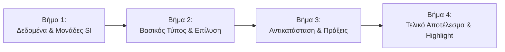

# Διαδραστικός Μαυροπίνακας & Animations Επίλυσης — 4gnosin.github.io

Το παρόν έγγραφο αναλύει τη μηχανή του **Διαδραστικού Μαυροπίνακα (Manim-Style Web Animation)** και την ανεξάρτητη αρχιτεκτονική **Plug & Play** για τα animations επίλυσης των ασκήσεων.

---

## 1. Φιλοσοφία & Εκπαιδευτική Προσέγγιση

Ο Διαδραστικός Μαυροπίνακας έχει σχεδιαστεί για να προσομοιώνει την εμπειρία της φυσικής διδασκαλίας στη σχολική τάξη:
* **Γραφή με κιμωλία:** Ο μαθητής παρακολουθεί τον «καθηγητή» να γράφει στον μαυροπίνακα χαρακτήρα-χαρακτήρα σε πραγματικό χρόνο (εφέ γραφομηχανής / chalk typewriter).
* **Μαθηματική ακρίβεια KaTeX:** Όλοι οι τύποι, τα κλάσματα, οι μονάδες και οι δείκτες αποδίδονται με τυπογραφική ποιότητα LaTeX.
* **Κατακόρυφη στοίχιση πράξεων:** Οι αριθμητικές αντικαταστάσεις στοιχίζονται αυστηρά στο σύμβολο του ίσον (`=`), εκπαιδεύοντας τον μαθητή στη σωστή μεθοδολογία των Πανελλαδικών Εξετάσεων.

---

## 2. Αρχιτεκτονική Plug & Play (Αποσύνδεση από τις Ασκήσεις)

Τα δεδομένα των animations **δεν βρίσκονται πλέον μέσα στα αρχεία των ασκήσεων**. Αντίθετα, φιλοξενούνται σε εντελώς ανεξάρτητα αρχεία στον φάκελο:

```text
site/animations/{grade}/{subject}/{exId}.js
```

### Παραδείγματα διαδρομών:
* `site/animations/b/thermod/ch05-20954.js`
* `site/animations/b/thermod/ch05-17114.js`
* `site/animations/c/stoixeia-michanon/ch14-25806.js`

### Πλεονεκτήματα της Αποσύνδεσης:
1. **Διαγραφή χωρίς τροποποίηση κώδικα:** Αν θέλετε να καταργήσετε ένα animation, **σβήνετε απλώς το αρχείο του** από τον δίσκο. Δεν ανοίγετε ούτε επεμβαίνετε στο αρχείο της άσκησης.
2. **Μηδενικός κίνδυνος σφάλματος (Fault Tolerance):** Αν ένα αρχείο animation λείπει ή διαγραφεί, η άσκηση λειτουργεί κανονικά ως απλή άσκηση, χωρίς κόκκινα σφάλματα στην κονσόλα.
3. **Ελαφριά αρχεία ασκήσεων:** Τα αρχεία στο `site/exercises/` παραμένουν λιτά και ευανάγνωστα (μόνο εκφωνήσεις, δεδομένα και αριθμητικές απαντήσεις).

---

## 3. Προδιαγραφές Δομής Αρχείου Animation (`.js`)

Κάθε αρχείο animation κατοχυρώνει τα βήματά του στο καθολικό μητρώο `window.EXERCISE_ANIMATIONS[exId]`:

```javascript
window.EXERCISE_ANIMATIONS = window.EXERCISE_ANIMATIONS || {};
window.EXERCISE_ANIMATIONS["ch05-20954"] = {
  "4.3": {                                     // Το υποερώτημα στο οποίο κουμπώνει (subq)
    "title": "Ερώτημα (4.3): Υπολογισμός ΔU", // Τίτλος μαυροπίνακα
    "steps": [
      // Τα 4 υποχρεωτικά βήματα (βλ. ενότητα 4)
    ]
  }
};
```

> **Υποστήριξη πολλαπλών ερωτημάτων:** Εάν μία άσκηση έχει animations σε παραπάνω από ένα υποερωτήματα (π.χ. στα ερωτήματα α, β, γ), αυτά δηλώνονται ως ξεχωριστά κλειδιά μέσα στο ίδιο αρχείο (π.χ. `"α": { ... }`, `"β": { ... }`).

---

## 4. Τα 4 Υποχρεωτικά Παιδαγωγικά Βήματα (`steps`)

Κάθε animation υπολογιστικού ερωτήματος ακολουθεί απαρέγκλιτα τη δομή των **4 βημάτων**:



### Αναλυτική Προδιαγραφή Πεδίων ανά Βήμα:
| Πεδίο | Τύπος | Περιγραφή |
| :--- | :--- | :--- |
| `step` | `number` | Αριθμός βήματος (`1`, `2`, `3`, `4`). |
| `kicker` | `string` | Σύντομος τίτλος καρτέλας (π.χ. `"Βήμα 1: Συλλογή Δεδομένων"`). |
| `text` | `string` | Πεζό κείμενο της επεξήγησης που γράφεται με εφέ κιμωλίας. |
| `description` | `string` | Σύνοψη του βήματος. |
| `math` | `string` | Μαθηματικός τύπος σε LaTeX (`\begin{aligned} ... \end{aligned}`). |
| `note` | `string` | Εκπαιδευτική σημείωση ή προειδοποίηση για τις εξετάσεις. |
| `highlight` | `boolean` | `true` μόνο στο 4ο βήμα για οπτική επισήμανση του τελικού αποτελέσματος. |

### Παράδειγμα Πλήρους Σχήματος:
```javascript
{
  "step": 1,
  "kicker": "Βήμα 1: Συλλογή Δεδομένων & Μετατροπές",
  "text": "Καταγραφή όλων των γνωστών δεδομένων της άσκησης και έλεγχος των μονάδων σε μονάδες SI.",
  "description": "Καταγραφή όλων των γνωστών δεδομένων της άσκησης.",
  "math": "\\begin{aligned}\nQ &= 0 \\\\\nW &= -450\\text{ kJ}\n\\end{aligned}",
  "note": "Όλα τα μεγέθη ελέγχονται αν βρίσκονται σε συμβατές μονάδες SI.",
  "highlight": false
},
{
  "step": 2,
  "kicker": "Βήμα 2: Επιλογή Βασικού Τύπου & Επίλυση",
  "text": "Επιλογή του 1ου θερμοδυναμικού αξιώματος και αλγεβρική επίλυση ως προς το ζητούμενο μέγεθος (ΔU).",
  "description": "Επιλογή βασικού τύπου και αλγεβρική επίλυση.",
  "math": "\\Delta U = -W",
  "note": "Αλγεβρική απομόνωση του ζητούμενου μεγέθους.",
  "highlight": false
},
{
  "step": 3,
  "kicker": "Βήμα 3: Αντικατάσταση & Απλοποιήσεις",
  "text": "Αντικατάσταση των αριθμητικών τιμών με κατακόρυφη στοίχιση των ισοτήτων.",
  "description": "Αντικατάσταση δεδομένων στον επιλυμένο τύπο.",
  "math": "\\begin{aligned}\n\\Delta U &= -(-450\\text{ kJ}) \\\\\n&= +450\\text{ kJ}\n\\end{aligned}",
  "note": "Προσοχή στις πράξεις προσήμων.",
  "highlight": false
},
{
  "step": 4,
  "kicker": "Βήμα 4: Τελικό Αποτέλεσμα & Μονάδα Μέτρησης",
  "text": "Προσδιορισμός της τελικής τιμής. Η εσωτερική ενέργεια του αερίου αυξήθηκε.",
  "description": "Τελική τιμή και μονάδα μέτρησης.",
  "math": "\\Delta U = +450\\text{ kJ}",
  "note": "Η αναγραφή της μονάδας μέτρησης (kJ) είναι υποχρεωτική στις εξετάσεις.",
  "highlight": true
}
```

---

## 5. Λειτουργία του Player στο Frontend (`site/js/app.js`)

Η συνάρτηση `renderManimPlayer(item, exId, itemIdx)` παρέχει τα εξής στοιχεία ελέγχου:
* **Κουμπί Αυτόματης Αναπαραγωγής (`▶ Play / ⏸ Pause`):** Προσομοιώνει τη ζωντανή γραφή βήμα-προς-βήμα.
* **Πλοήγηση:** `⏮ Πίσω`, `Επόμενο Βήμα ⏭`, `🔄 Αρχή`.
* **Καρτέλες Βημάτων (Pills):** Ο μαθητής μπορεί να πατήσει απευθείας σε όποιο βήμα επιθυμεί (π.χ. «Βήμα 3»).
* **Εμφάνιση στην Άσκηση:**
  * Στη λίστα ασκήσεων (`Board`) εμφανίζεται το badge **`🎬 Animation`**.
  * Στην κορυφή της άσκησης εμφανίζεται το κεντρικό **Hero Banner**.
  * Στο κουμπί υπόδειξης του ερωτήματος εμφανίζεται η επιλογή **`Υπόδειξη & Animation 🎬`**.

---

## 6. Οδηγός Διαχείρισης

### 6.1 Πώς προσθέτω νέο animation:
1. Δημιουργήστε το αρχείο `site/animations/{grade}/{subject}/{exId}.js`.
2. Καταχωρήστε τα 4 βήματα στο `window.EXERCISE_ANIMATIONS["{exId}"]`.
3. Εκτελέστε:
   ```bash
   python scripts/build_scripts_catalog.py
   ```
   Το αρχείο συμπεριλαμβάνεται αυτόματα στο Lazy Loading του μαθήματος.

### 6.2 Πώς διαγράφω ένα animation:
1. Διαγράψτε το αρχείο `site/animations/{grade}/{subject}/{exId}.js` (πατήστε Delete).
2. *(Προαιρετικά)* Τρέξτε ξανά `python scripts/build_scripts_catalog.py` για να καθαρίσει από τον κατάλογο.
> Η άσκηση παραμένει 100% λειτουργική από το πρώτο δευτερόλεπτο της διαγραφής.

### 6.3 Αυτόματη Παραγωγή μέσω του Εργαλείου `calc_animator.py`

Το portal διαθέτει ειδικό εργαλείο παραγωγής animations (`src/tools/calc_animator.py`), το οποίο είναι πλήρως ευθυγραμμισμένο με την απομονωμένη αρχιτεκτονική:

* **Σάρωση Κατάστασης:**
  ```bash
  python -m src.tools.calc_animator --scan
  ```
  Αναφέρει το ποσοστό κάλυψης animations ανά μάθημα και κεφάλαιο, ελέγχοντας άμεσα τον φάκελο `site/animations/`.

* **Στοχευμένη Παραγωγή μεμονωμένης Άσκησης:**
  ```bash
  python -m src.tools.calc_animator --target 20954 --mode hybrid
  ```

* **Μαζική Παραγωγή ανά Κεφάλαιο ή Μάθημα:**
  ```bash
  python -m src.tools.calc_animator --subject thermo --chapter 5
  ```

* **Μέθοδοι Παραγωγής (`--mode`):**
  1. `hybrid` (Προεπιλογή): Script-first (άμεσο, 0 tokens) και AI fallback μόνο αν λείπουν τύποι/λύση.
  2. `local`: 100% ντετερμινιστικός Python builder (0 AI tokens, ακαριαία εκτέλεση).
  3. `ai-pedagogy`: Script builder + Παιδαγωγικός Επιθεωρητής Gemini API για ενίσχυση του διδακτικού λόγου.

> **Αυτοματοποίηση Καταλόγου:** Μετά από κάθε παραγωγή νέου animation, το εργαλείο καλεί αυτόματα τη διαδικασία `build_bundles()`, ενημερώνοντας το `site/content/scripts_catalog.js` και τα bundles χωρίς να απαιτείται καμία χειροκίνητη ενέργεια. Τα αρχεία ασκήσεων (`site/exercises/`) παραμένουν πάντα 100% καθαρά.
