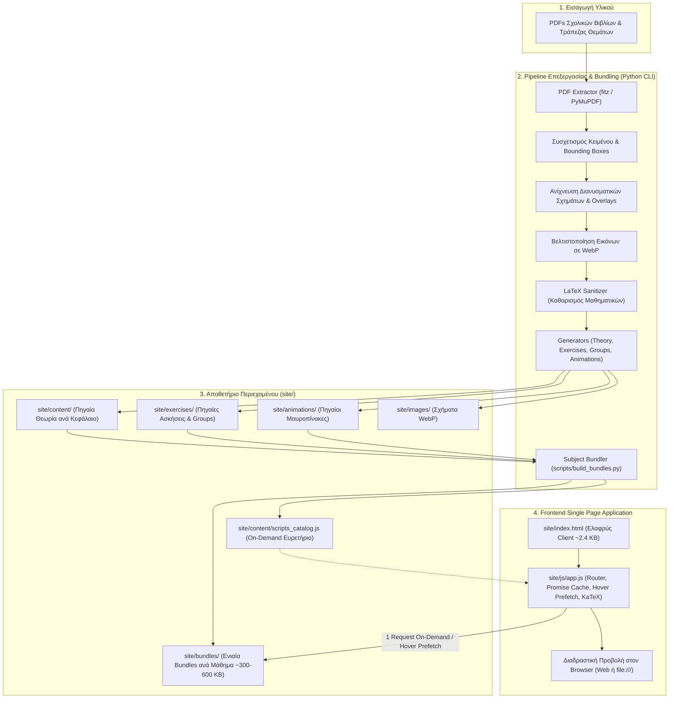

# Αρχιτεκτονική Συστήματος — 4gnosin.github.io

**Γλώσσα / Language:** Ελληνικά | [English](en/architecture.md)

Το παρόν έγγραφο αναλύει την τεχνική αρχιτεκτονική, τη ροή δεδομένων και τον μηχανισμό εκτέλεσης της εκπαιδευτικής πλατφόρμας **4gnosin.github.io**.

---

## 1. Συνολική Ροή Δεδομένων (End-to-End Pipeline)

Η πλατφόρμα αποτελείται από δύο διακριτούς κόσμους:
1. **Backend / Generation Pipeline (Python):** Επεξεργασία PDFs, OCR, εξαγωγή διανυσματικών σχημάτων και εικόνων, καθαρισμός μαθηματικών τύπων (LaTeX sanitizer), παραγωγή δομημένων αρχείων JavaScript και αυτόματο bundling ανά μάθημα.
2. **Frontend Client (Vanilla JS Single Page Application):** Στατική εφαρμογή που εκτελείται 100% στον φυλλομετρητή (browser) χωρίς ανάγκη για backend server, βάση δεδομένων ή Node.js runtime.



---

## 2. Ο Κανόνας "Zero-Fetch" & Συμβατότητα με `file:///`

### 2.1 Το Πρόβλημα του `fetch()` σε Τοπικό Περιβάλλον
Σε πολλά σχολεία και εργαστήρια ΕΠΑ.Λ., το site διανέμεται σε USB sticks ή ανοίγει τοπικά με διπλό κλικ στο `index.html` (πρωτόκολλο `file:///`) χωρίς σύνδεση στο internet και χωρίς τοπικό HTTP server (`http://localhost`).
* Οι σύγχρονοι browsers (Chrome, Edge, Firefox) **μπλοκάρουν εντολές `fetch()` και `XMLHttpRequest`** όταν εκτελούνται υπό το πρωτόκολλο `file:///` λόγω περιορισμών ασφαλείας CORS (*Cross-Origin Resource Sharing*).

### 2.2 Η Αρχιτεκτονική Λύση: Global Namespace Injection
Όλα τα δεδομένα της πλατφόρμας είναι αποθηκευμένα σε αρχεία JavaScript (`.js`), τα οποία φορτώνονται μέσω κανονικών tags:
```html
<script src="path/to/file.js"></script>
```
Τα tags αυτά εκτελούνται ελεύθερα τόσο στο διαδίκτυο (GitHub Pages) όσο και σε τοπικό δίσκο (`file:///`).

Κάθε αρχείο προσαρτά τα δεδομένα του σε καθολικά αντικείμενα του `window`:
* `window.SUBJECT_DATA`: Περιέχει τα δεδομένα θεωρίας (`sections`), ομάδων (`groups`) και ασκήσεων (`exercises`) του ενεργού μαθήματος (όλα τα νέα μαθήματα).
* `window.SECTIONS`, `window.GROUPS`, `window.EXERCISES`: Legacy καθολικοί πίνακες που διατηρούνται για τα υπάρχοντα αρχεία της Θερμοδυναμικής (`thermo` στον φάκελο `b/thermod/`). Η `subjectData("thermo")` στο `app.js` τους συνενώνει αυτόματα με το `window.SUBJECT_DATA["thermo"]`.
* `window.SUBJECT_SCRIPTS`: Ευρετήριο ενεργών scripts ανά μάθημα (δείχνει στο ενιαίο `bundles/{subject}.bundle.js` για φόρτωση με 1 αίτημα, ή στα μεμονωμένα αρχεία όταν παραχθεί με `--raw`).
* `window.SUBJECT_RAW_SCRIPTS`: Πλήρες ευρετήριο των αρχικών πηγαίων αρχείων ανά μάθημα (για ανάπτυξη / αναφορά).
* `window.EXERCISE_ANIMATIONS`: Ανεξάρτητο μητρώο για τα βήματα του διαδραστικού μαυροπίνακα ανά `exId` και `subq`.

> **Σύμβαση Slug `thermo` vs `b/thermod`:** Το canonical `id` στον κατάλογο `site/content/catalog.js` και στο routing του `site/js/app.js` είναι **`thermo`**, ενώ ο φάκελος στον δίσκο παραμένει **`b/thermod`** (`site/content/b/thermod/`, `site/exercises/b/thermod/`, `site/animations/b/thermod/`). Το `scripts/build_bundles.py` μεταφράζει αυτόματα το `thermod` σε `"thermo"` κατά τη δημιουργία του `thermo.bundle.js` και του `scripts_catalog.js`.

---

## 3. Μηχανισμός Φόρτωσης & Επιδόσεων (High-Speed Lazy Loading)

### 3.1 Η Αρχιτεκτονική Εξέλιξη
1. **Φάση 1 (Μονολιθική — `index_full.html`):** Φόρτωνε όλα τα αρχεία στην εκκίνηση. Η αρχική σελίδα ήταν αργή.
2. **Φάση 2 (Απλό Lazy Loading με μεμονωμένα αρχεία):** Η αρχική σελίδα έγινε γρήγορη, αλλά η επιλογή ενός μαθήματος απαιτούσε 80–110 ξεχωριστά αιτήματα δικτύου (HTTP requests), προκαλώντας καθυστέρηση 2–4 δευτερολέπτων.
3. **Φάση 3 (Παραγωγή — Subject Bundles + Hover Prefetching):** Η αρχική σελίδα παραμένει αστραπιαία, ενώ κάθε μάθημα συνενώνεται σε **1 μόνο αρχείο bundle** (~300–600 KB).

### 3.2 Πώς Λειτουργεί στην Παραγωγή (`site/index.html` + `site/js/app.js`)
* **Μέγεθος Αρχικής Σελίδας:** ~2.4 KB (μόλις 39 γραμμές).
* **Εκκίνηση:** Φορτώνονται μόνο ο σκελετός HTML, το KaTeX, το CSS, το `catalog.js`, το `scripts_catalog.js`, οι προσομοιώσεις, τα βασικά μαθηματικά και το `site/js/app.js`. Μηδενική καθυστέρηση στην αρχική.
* **Hover / Pointer Prefetching:** Όταν ο κέρσορας πλησιάσει (ή αγγίξει σε οθόνη αφής) την κάρτα ενός μαθήματος στην αρχική σελίδα, το `app.js` ξεκινά αθόρυβα την προφόρτωση του bundle στο παρασκήνιο. Όταν ο χρήστης πατήσει κλικ, το μάθημα είναι ήδη στη μνήμη (**0 ms perceived latency**).
* **Promise Caching:** Η `ensureSubjectLoaded(subjectId)` διατηρεί cache φόρτωσης, αποτρέποντας διπλότυπες εγγραφές `<script>` tags στο DOM ή race conditions κατά την πλοήγηση.
* **Ανθεκτικότητα Σφαλμάτων:** Ακόμη κι αν κάποιο script αποτύχει, ο event handler `s.onerror` αποτρέπει το πάγωμα της εφαρμογής.

### 3.3 `site/index_full.html` (Η εφεδρική μονολιθική έκδοση — Fallback / Debug)
* Περιέχει στατικά δηλωμένα `<script>` tags για κάθε αρχείο θεωρίας, άσκησης και animation όλων των μαθημάτων. Παραμένει ως αυτόνομο αντίγραφο ασφαλείας για περιβάλλοντα που δεν υποστηρίζουν δυναμική εισαγωγή scripts.

---

## 4. Δρομολόγηση (Hash Routing)

Το `site/js/app.js` υλοποιεί έναν ελαφρύ SPA Router βασισμένο στο `window.location.hash`:

| Hash Route Pattern | Σελίδα Προβολής | Περιγραφή |
| :--- | :--- | :--- |
| `#/` | Αρχική Σελίδα (Home) | Επιλογή τάξης, προσομοιώσεων, χρήσιμων links και βασικών μαθηματικών. |
| `#/grade/{b\|c}` | Κατάλογος Τάξης | Μαθήματα και ειδικότητες της επιλεγμένης τάξης ΕΠΑ.Λ. |
| `#/{subject}` | Επισκόπηση Μαθήματος | Περιεχόμενα, σύνδεσμοι θεωρίας και ασκήσεων του μαθήματος. |
| `#/{subject}/notes` | Ευρετήριο Σημειώσεων | Συγκεντρωτική λίστα κεφαλαίων θεωρίας. |
| `#/{subject}/notes/{slug}` | Σελίδα Θεωρίας (Section) | Πλήρες κείμενο ενότητας με μαθηματικούς τύπους, εικόνες και επεξηγήσεις. |
| `#/{subject}/board` | Πίνακας Ασκήσεων (Board) | Όλες οι ασκήσεις ανά κεφάλαιο με ενδείξεις προόδου και badges `Animation`. |
| `#/{subject}/board/{exId}` | Σελίδα Άσκησης | Διαδραστική επίλυση με άμεσο έλεγχο, υποδείξεις, βήματα μαυροπίνακα και σχήματα λύσης. |
| `#/simulations` & `#/simulations/{id}` | Προσομοιώσεις | Κατάλογος και διαδραστικές προσομοιώσεις (`fwg`, `hydrophore`, `ejector-evaporator`). |
| `#/math` & `#/math/{category}` | Βασικά Μαθηματικά | Οδηγοί αναφοράς (κλάσματα, ταυτότητες, δυνάμεις, παραγοντοποίηση). |
| `#/links` | Χρήσιμα Links | Εξωτερικοί σύνδεσμοι για μαθήματα και σχολικό υλικό. |

---

## 5. Δομή Φακέλων & Διαχωρισμός Ευθυνών

```text
site/
├── index.html                 # Κύρια σελίδα παραγωγής (High-Speed Lazy Loading)
├── index_full.html            # Εφεδρική μονολιθική σελίδα (Fallback)
├── css/
│   └── style.css              # Ενιαίο responsive design, θέμα μαυροπίνακα & κιμωλίας
├── js/
│   └── app.js                 # SPA Router, Promise Cache, Hover Prefetch, Chalkboard player
├── bundles/                   # Ενιαία bundles ανά μάθημα (1 αρχείο/μάθημα για φόρτωση με 1 αίτημα)
│   └── {subject}.bundle.js    # Συνενωμένη θεωρία, ασκήσεις, ομάδες & animations (~300-600 KB)
├── content/                   # Πηγαία Θεωρία (Sections)
│   ├── catalog.js             # Κατάλογος μαθημάτων, τάξεων και τίτλων
│   ├── scripts_catalog.js     # Χάρτης ενεργών bundles (και raw scripts) ανά μάθημα
│   └── {grade}/{subject}/...  # Πηγαία αρχεία θεωρίας ανά κεφάλαιο (π.χ. 01-genika.js)
├── exercises/                 # Πηγαίες Ασκήσεις Τράπεζας Θεμάτων
│   └── {grade}/{subject}/...
│       ├── groups.js          # Ομαδοποίηση υποενοτήτων ανά κεφάλαιο
│       └── chNN-MM-slug.js    # Ασκήσεις (mc, tf, calc, match, blank, open)
├── animations/                # Διαδραστικοί Μαυροπίνακες (απομονωμένα αρχεία πηγής)
│   └── {grade}/{subject}/
│       └── {exId}.js          # Ανεξάρτητο animation ανά άσκηση
└── images/                    # Βελτιστοποιημένα τεχνικά σχήματα & διαγράμματα (WebP)
    └── {grade}/{subject}/...  # {stem}_{code}_figNN.webp / solNN.webp

scripts/
├── build_bundles.py           # Κατασκευή bundles ανά μάθημα & ενημέρωση scripts_catalog.js
├── build_scripts_catalog.py   # Compatibility wrapper που καλεί το build_bundles.py
├── build_bundles.bat          # Εκτέλεση με διπλό κλικ σε Windows
├── menu.py                    # Control Center (διαδραστικό TUI μενού)
└── ...                        # Εργαλεία λήψης ΙΕΠ/βιβλίων, WebP, theory.py, site_server.py
```

---

## 6. Αυτοματισμός & Συντήρηση

* **Προσθήκη / Επεξεργασία Υλικού:** Ο προγραμματιστής / συντάκτης εργάζεται στα επιμέρους πηγαία αρχεία (`content/`, `exercises/`, `animations/`).
* **Ενημέρωση Παραγωγής:** Μετά από **οποιαδήποτε** προσθήκη, αλλαγή ή διαγραφή αρχείου θεωρίας, άσκησης ή animation, εκτελείται το `python scripts/build_bundles.py` (ή το `scripts/build_bundles.bat` / `scripts/menu.py`), ώστε να αναδομηθούν τα `site/bundles/{subject}.bundle.js` και το `site/content/scripts_catalog.js`.
* **Έλεγχος Ορθότητας:** Ο `SiteValidator` (`src/validators/site_validator.py`, τόσο μέσω `python -m src.cli validate` όσο και αυτόνομα) επικυρώνει τα αρχεία θεωρίας (`site/content/`), ασκήσεων/ομάδων (`site/exercises/`) και animations (`site/animations/`).
