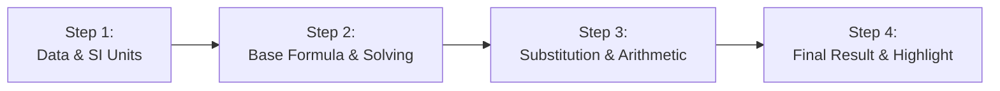

# Interactive Blackboard & Solution Animations — 4gnosin.github.io

**Language / Γλώσσα:** [Ελληνικά](../animations.md) | English

This document analyzes the **Interactive Blackboard (Manim-Style Web Animation)** engine and the decoupled **Plug & Play** architecture for exercise solution animations.

---

## 1. Philosophy & Educational Approach

The Interactive Blackboard is designed to simulate the classroom teaching experience:
* **Chalk Writing:** The student watches the instructor write on the blackboard character-by-character in real time (chalk typewriter effect).
* **KaTeX Mathematical Precision:** All formulas, fractions, units, and subscripts are rendered with LaTeX typographic quality.
* **Vertical Equation Alignment:** Numerical substitutions are strictly aligned at the equals sign (`=`), training the student in proper Panhellenic Exam presentation methodology.

---

## 2. Plug & Play Architecture (Decoupled from Exercises)

Animation data **no longer resides inside exercise files**. Instead, it is stored in completely independent files under:

```text
site/animations/{grade}/{subject}/{exId}.js
```

### Example paths:
* `site/animations/b/thermod/ch05-20954.js`
* `site/animations/b/thermod/ch05-17114.js`
* `site/animations/c/stoixeia-michanon/ch14-25806.js`

### Benefits of Decoupling:
1. **Removal without editing code:** To remove an animation, **simply delete its file** from disk. There is no need to open or modify the exercise file.
2. **Fault Tolerance:** If an animation file is missing or deleted, the exercise continues working normally as a standard exercise, with no console errors.
3. **Lightweight exercise files:** Files in `site/exercises/` remain clean and readable (containing only problem statements, givens, and numerical answers).

---

## 3. Animation File Structure Specifications (`.js`)

Each animation file registers its steps in the global registry `window.EXERCISE_ANIMATIONS[exId]`:

```javascript
window.EXERCISE_ANIMATIONS = window.EXERCISE_ANIMATIONS || {};
window.EXERCISE_ANIMATIONS["ch05-20954"] = {
  "4.3": {                                     // The sub-question it attaches to (subq)
    "title": "Ερώτημα (4.3): Υπολογισμός ΔU", // Blackboard title
    "steps": [
      // The 4 mandatory steps (see section 4)
    ]
  }
};
```

> **Multi-question support:** If an exercise has animations for more than one sub-question (e.g. questions a, b, c), they are declared as separate keys inside the same file (e.g. `"α": { ... }`, `"β": { ... }`).

---

## 4. The 4 Mandatory Pedagogical Steps (`steps`)

Every calculation sub-question animation strictly follows the **4-step** structure:



### Detailed Field Specification per Step:
| Field | Type | Description |
| :--- | :--- | :--- |
| `step` | `number` | Step number (`1`, `2`, `3`, `4`). |
| `kicker` | `string` | Short step label (e.g. `"Βήμα 1: Συλλογή Δεδομένων"`). |
| `text` | `string` | Explanatory prose rendered with the chalk-writing effect. |
| `description` | `string` | Step summary. |
| `math` | `string` | Mathematical formula in LaTeX (`\begin{aligned} ... \end{aligned}`). |
| `note` | `string` | Educational note or exam warning. |
| `highlight` | `boolean` | `true` only on step 4 to visually highlight the final result. |

### Full Schema Example:
```javascript
{
  "step": 1,
  "kicker": "Βήμα 1: Συλλογή Δεδομένων & Μετατροπές",
  "text": "Καταγραφή όλων των γνωστών δεδομένων της άσκησης και έλεγχος των μονάδων σε μονάδες SI.",
  "description": "Καταγραφή όλων των γνωστών δεδομένων της άσκησης.",
  "math": "\\begin{aligned}\nQ &= 0 \\\\\nW &= -450\\text{ kJ}\n\\end{aligned}",
  "note": "Όλα τα μεγέθη ελέγχονται αν βρίσκονται σε συμβατές μονάδες SI.",
  "highlight": false
},
{
  "step": 2,
  "kicker": "Βήμα 2: Επιλογή Βασικού Τύπου & Επίλυση",
  "text": "Επιλογή του 1ου θερμοδυναμικού αξιώματος και αλγεβρική επίλυση ως προς το ζητούμενο μέγεθος (ΔU).",
  "description": "Επιλογή βασικού τύπου και αλγεβρική επίλυση.",
  "math": "\\Delta U = -W",
  "note": "Αλγεβρική απομόνωση του ζητούμενου μεγέθους.",
  "highlight": false
},
{
  "step": 3,
  "kicker": "Βήμα 3: Αντικατάσταση & Απλοποιήσεις",
  "text": "Αντικατάσταση των αριθμητικών τιμών με κατακόρυφη στοίχιση των ισοτήτων.",
  "description": "Αντικατάσταση δεδομένων στον επιλυμένο τύπο.",
  "math": "\\begin{aligned}\n\\Delta U &= -(-450\\text{ kJ}) \\\\\n&= +450\\text{ kJ}\n\\end{aligned}",
  "note": "Προσοχή στις πράξεις προσήμων.",
  "highlight": false
},
{
  "step": 4,
  "kicker": "Βήμα 4: Τελικό Αποτέλεσμα & Μονάδα Μέτρησης",
  "text": "Προσδιορισμός της τελικής τιμής. Η εσωτερική ενέργεια του αερίου αυξήθηκε.",
  "description": "Τελική τιμή και μονάδα μέτρησης.",
  "math": "\\Delta U = +450\\text{ kJ}",
  "note": "Η αναγραφή της μονάδας μέτρησης (kJ) είναι υποχρεωτική στις εξετάσεις.",
  "highlight": true
}
```

---

## 5. Frontend Player Behavior (`site/js/app.js`)

`renderManimPlayer(item, exId, itemIdx)` provides the following controls:
* **Auto-Play Toggle (`Play` / `Pause`):** Simulates live step-by-step writing.
* **Navigation:** `Back`, `Next Step`, `Restart` (replay).
* **Step Pills:** Students can jump directly to any step (e.g. "Step 3").
* **Exercise Visibility:**
  * In the exercise list (`Board`), an **Animation** badge is shown.
  * At the top of the exercise, the central **Hero Banner** appears.
  * On the question's hint button, the **`Hint & Animation`** (`Υπόδειξη & Animation`) option is shown.

---

## 6. Management Guide

### 6.1 How to add a new animation:
1. Create the file `site/animations/{grade}/{subject}/{exId}.js`.
2. Register the 4 steps under `window.EXERCISE_ANIMATIONS["{exId}"]`.
3. Run:
   ```bash
   python scripts/build_scripts_catalog.py
   ```
   The file is automatically included in the subject's Lazy Loading catalog.

### 6.2 How to delete an animation:
1. Delete the file `site/animations/{grade}/{subject}/{exId}.js`.
2. *(Optional)* Re-run `python scripts/build_scripts_catalog.py` to remove it from the catalog.
> The exercise remains 100% functional immediately upon deletion.

### 6.3 Automatic Generation via `calc_animator.py`

The portal includes a dedicated animation generator (`src/tools/calc_animator.py`), fully aligned with the decoupled architecture:

* **Status Scan:**
  ```bash
  python -m src.tools.calc_animator --scan
  ```
  Reports animation coverage per subject and chapter by scanning `site/animations/` directly.

* **Targeted Single-Exercise Generation:**
  ```bash
  python -m src.tools.calc_animator --target 20954 --mode hybrid
  ```

* **Batch Generation per Chapter or Subject:**
  ```bash
  python -m src.tools.calc_animator --subject thermo --chapter 5
  ```

* **Generation Modes (`--mode`):**
  1. `hybrid` (Default): Script-first (instant, 0 tokens) with AI fallback only when formulas/solutions are missing.
  2. `local`: 100% deterministic Python builder (0 AI tokens, instantaneous execution).
  3. `ai-pedagogy`: Script builder + Gemini API Pedagogical Reviewer to enhance instructional explanations.

> **Catalog Automation:** After generating any new animation, the tool automatically invokes `build_bundles()`, updating `site/content/scripts_catalog.js` and the subject bundles with zero manual intervention. Exercise files (`site/exercises/`) always remain 100% untouched.
