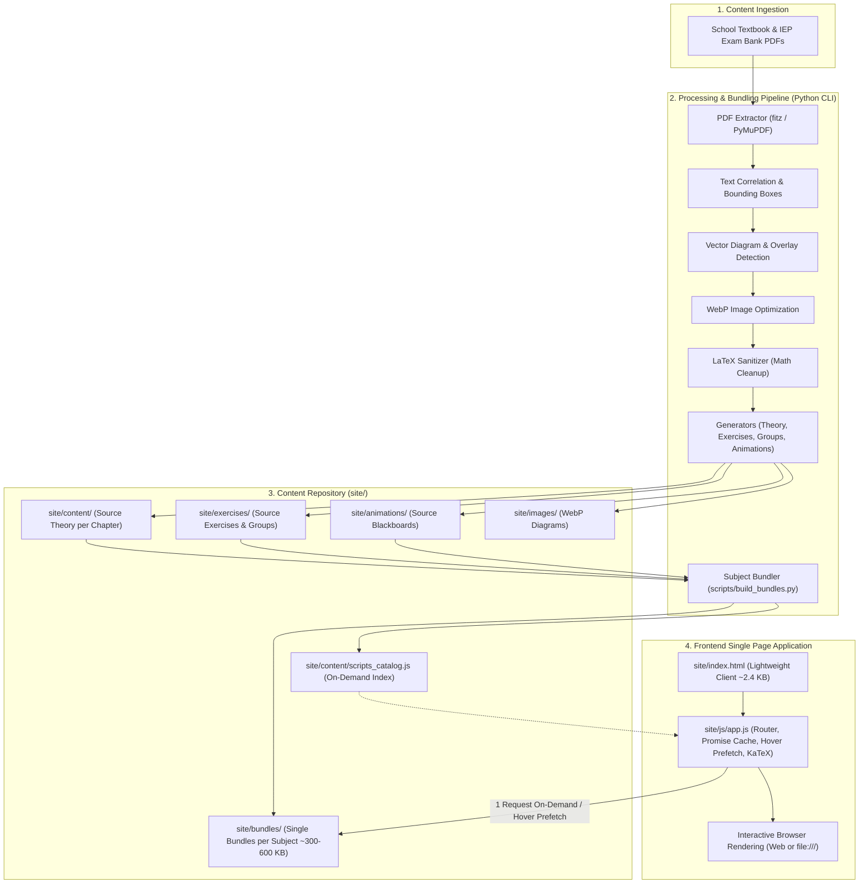

# System Architecture — 4gnosin.github.io

**Language / Γλώσσα:** [Ελληνικά](../architecture.md) | English

This document details the technical architecture, data flow, and execution model of the **4gnosin.github.io** educational platform.

---

## 1. End-to-End Data Flow

The platform consists of two distinct layers:
1. **Backend / Generation Pipeline (Python):** PDF processing, OCR, extraction of vector diagrams and images, mathematical formula cleanup (LaTeX sanitizer), generation of structured JavaScript files, and automatic per-subject bundling.
2. **Frontend Client (Vanilla JS Single Page Application):** A static application running 100% in the browser with no backend server, database, or Node.js runtime required.



---

## 2. The "Zero-Fetch" Rule & `file:///` Compatibility

### 2.1 The `fetch()` Problem in Local Environments
In many EPAL schools and labs, the site is distributed on USB sticks or opened locally by double-clicking `index.html` (`file:///` protocol) with no internet connection and no local HTTP server (`http://localhost`).
* Modern browsers (Chrome, Edge, Firefox) **block `fetch()` and `XMLHttpRequest` calls** when running over the `file:///` protocol due to CORS (*Cross-Origin Resource Sharing*) security restrictions.

### 2.2 The Architectural Solution: Global Namespace Injection
All platform data is stored in JavaScript (`.js`) files loaded via standard script tags:
```html
<script src="path/to/file.js"></script>
```
These tags execute unrestricted both online (GitHub Pages) and from local disk (`file:///`).

Each file attaches its data to global `window` objects:
* `window.SUBJECT_DATA`: Holds theory (`sections`), group (`groups`), and exercise (`exercises`) data for the active subject (used by all newer subjects).
* `window.SECTIONS`, `window.GROUPS`, `window.EXERCISES`: Legacy global arrays preserved for existing Thermodynamics (`thermo`, stored under `b/thermod/`) files. `subjectData("thermo")` in `app.js` automatically merges them with `window.SUBJECT_DATA["thermo"]`.
* `window.SUBJECT_SCRIPTS`: Index of active scripts per subject (points to the unified `bundles/{subject}.bundle.js` for single-request loading, or to individual files when built with `--raw`).
* `window.SUBJECT_RAW_SCRIPTS`: Complete index of the original source files per subject (for development / reference).
* `window.EXERCISE_ANIMATIONS`: Independent registry for the interactive blackboard steps keyed by `exId` and `subq`.

> **`thermo` vs `b/thermod` Slug Convention:** The canonical `id` in `site/content/catalog.js` and `site/js/app.js` routing is **`thermo`**, whereas the filesystem directory remains **`b/thermod`** (`site/content/b/thermod/`, `site/exercises/b/thermod/`, `site/animations/b/thermod/`). `scripts/build_bundles.py` automatically maps `thermod` to `"thermo"` when generating `thermo.bundle.js` and `scripts_catalog.js`.

---

## 3. Loading Mechanism & Performance (High-Speed Lazy Loading)

### 3.1 Architectural Evolution
1. **Phase 1 (Monolithic — `index_full.html`):** Loaded all files on startup. The landing page was slow.
2. **Phase 2 (Simple Lazy Loading with individual files):** The landing page became fast, but selecting a subject required 80–110 separate network (HTTP) requests, causing a 2–4 second delay.
3. **Phase 3 (Production — Subject Bundles + Hover Prefetching):** The landing page remains instantaneous, while each subject is merged into **a single bundle file** (~300–600 KB).

### 3.2 How Production Works (`site/index.html` + `site/js/app.js`)
* **Landing Page Size:** ~2.4 KB (just 39 lines).
* **Startup:** Only the HTML shell, KaTeX, CSS, `catalog.js`, `scripts_catalog.js`, simulations, basic math modules, and `site/js/app.js` are loaded. Zero startup latency on the home view.
* **Hover / Pointer Prefetching:** When the pointer hovers over (or touches on a touchscreen) a subject card on the home page, `app.js` silently prefetches the subject bundle in the background. When the user clicks, the subject is already cached in memory (**0 ms perceived latency**).
* **Promise Caching:** `ensureSubjectLoaded(subjectId)` maintains a loading cache, preventing duplicate DOM `<script>` tag insertions or navigation race conditions.
* **Fault Tolerance:** Even if a script fails to load, the `s.onerror` handler prevents the application from freezing.

### 3.3 `site/index_full.html` (Monolithic Backup — Fallback / Debug)
* Contains statically declared `<script>` tags for every theory, exercise, and animation file across all subjects. Maintained as a standalone backup for environments that do not support dynamic script injection.

---

## 4. Routing (Hash Routing)

`site/js/app.js` implements a lightweight SPA router based on `window.location.hash`:

| Hash Route Pattern | View Page | Description |
| :--- | :--- | :--- |
| `#/` | Home Page | Grade selection, simulations, useful links, and basic mathematics. |
| `#/grade/{b\|c}` | Grade Catalog | Courses and specializations for the selected EPAL grade. |
| `#/{subject}` | Course Overview | Table of contents, links to theory and exercises for the course. |
| `#/{subject}/notes` | Notes Index | Consolidated list of theory chapters. |
| `#/{subject}/notes/{slug}` | Theory Page (Section) | Full section text with mathematical formulas, images, and explanations. |
| `#/{subject}/board` | Exercise Board | All exercises grouped by chapter with progress indicators and `Animation` badges. |
| `#/{subject}/board/{exId}` | Exercise Page | Interactive solving with instant validation, hints, blackboard steps, and solution diagrams. |
| `#/simulations` & `#/simulations/{id}` | Simulations | Catalog and interactive simulations (`fwg`, `hydrophore`, `ejector-evaporator`). |
| `#/math` & `#/math/{category}` | Basic Mathematics | Reference guides (fractions, algebraic identities, powers, factorization). |
| `#/links` | Useful Links | External links for courses and educational resources. |

---

## 5. Folder Structure & Separation of Concerns

```text
site/
├── index.html                 # Main production page (High-Speed Lazy Loading)
├── index_full.html            # Monolithic fallback page (Fallback)
├── css/
│   └── style.css              # Unified responsive design, blackboard & chalk theme
├── js/
│   └── app.js                 # SPA Router, Promise Cache, Hover Prefetch, Chalkboard player
├── bundles/                   # Unified bundles per subject (1 file/subject for single-request loading)
│   └── {subject}.bundle.js    # Combined theory, exercises, groups & animations (~300-600 KB)
├── content/                   # Source Theory (Sections)
│   ├── catalog.js             # Catalog of courses, grades, and titles
│   ├── scripts_catalog.js     # Map of active bundles (and raw scripts) per subject
│   └── {grade}/{subject}/...  # Source theory files per chapter (e.g. 01-genika.js)
├── exercises/                 # Source IEP Exam Bank Exercises
│   └── {grade}/{subject}/...
│       ├── groups.js          # Subsection grouping per chapter
│       └── chNN-MM-slug.js    # Exercises (mc, tf, calc, match, blank, open)
├── animations/                # Interactive Blackboards (decoupled source files)
│   └── {grade}/{subject}/
│       └── {exId}.js          # Independent animation per exercise
└── images/                    # Optimized technical figures & diagrams (WebP)
    └── {grade}/{subject}/...  # {stem}_{code}_figNN.webp / solNN.webp

scripts/
├── build_bundles.py           # Builds per-subject bundles & updates scripts_catalog.js
├── build_scripts_catalog.py   # Compatibility wrapper that invokes build_bundles.py
├── build_bundles.bat          # Double-click execution on Windows
├── menu.py                    # Control Center (interactive TUI menu)
└── ...                        # IEP/book downloaders, WebP optimizer, theory.py, site_server.py
```

---

## 6. Automation & Maintenance

* **Adding / Editing Content:** Authors and developers work in the individual source files (`content/`, `exercises/`, `animations/`).
* **Production Updates:** After **any** addition, edit, or deletion of a theory, exercise, or animation file, run `python scripts/build_bundles.py` (or `scripts/build_bundles.bat` / `scripts/menu.py`) to rebuild `site/bundles/{subject}.bundle.js` and `site/content/scripts_catalog.js`.
* **Validation:** `SiteValidator` (`src/validators/site_validator.py`, both via `python -m src.cli validate` and directly) validates theory files (`site/content/`), exercise/group files (`site/exercises/`), and animations (`site/animations/`).
